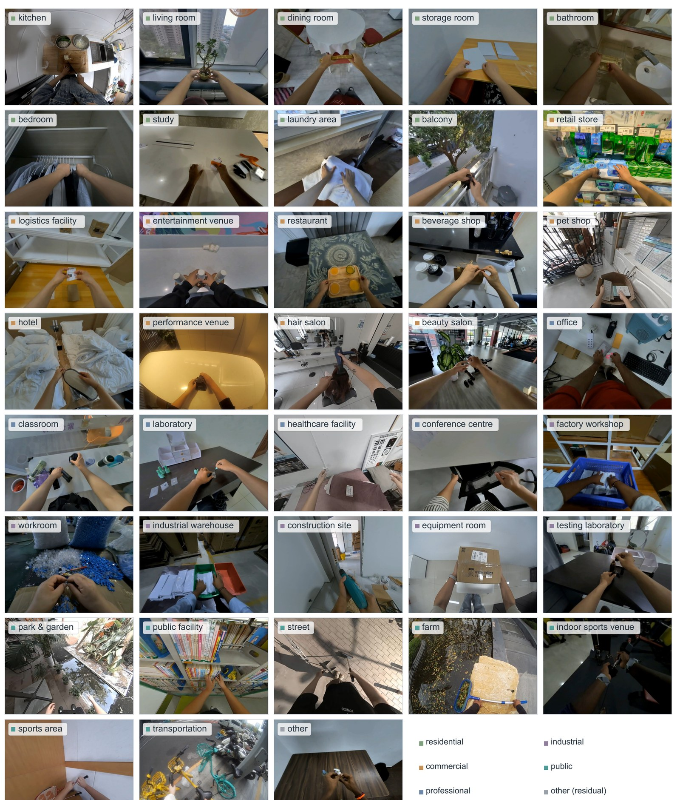

# HumanCOIN

<p align="center">
  
</p>

**A 12,500-hour egocentric manipulation dataset that records the signals behind the action — gaze, surface EMG and EEG — at three measurement depths, on one task ontology and one time base.**

<p align="center">
  <a href="https://flagopen.github.io/HumanCOIN/">Project page</a> ·
  <a href="https://arxiv.org/abs/2611.26434">Technical report</a> ·
  <a href="https://flagopen.github.io/HumanCOIN-Doc/">Documentation</a> ·
  <a href="https://flagopen.github.io/HumanCOIN-DataManager/">Data portal</a> ·
  <a href="#community">Community</a>
</p>

> 中文版：[README_zh-CN.md](README_zh-CN.md)

<p align="center">
  
  <br>
  <sub>Questions? Ideas? Come join the group · 有问题、有想法，都来群里聊</sub>
</p>

## What is HumanCOIN?

Most egocentric datasets keep an observation–action pair. A policy trained on that pair learns `π(a | o)` and folds the operator's intent into its weights; when it fails, the data does not say whether the target was wrong, the grip force was misjudged, or an error signal was missed.

HumanCOIN records the middle of that pathway. Every episode carries wearable proxies for intent:

- **gaze** — where attention lands before the hand moves;
- **surface EMG** — how the forearm loads grip force before contact;
- **scalp EEG** — what the cortex prepares before the motor command.

These are measurements and estimates, not ground-truth intent. The corpus is built so that a model can learn a proxy model `p(m | o)`, train an intent-conditioned policy `p(a | o, m)`, and compare it with `p(a | o)`. The controlled L3 subset measures gaze, pose and finger kinematics directly, giving the shallower tiers a reference to be scored against.

## At a glance

| Axis | Value |
|------|-------|
| Scale | 12,500 hours · 1.35 B master frames at 30 fps · 6 collection sites |
| Scenes | 38 classes in 5 zones + 1 residual |
| Tasks | 99 task verbs + 46 motion verbs |
| Objects | 635 annotated classes; 839 measured instances |
| Signals | multi-view RGB, metric depth and point clouds, 6-DoF pose, hand kinematics, gaze, sEMG, EEG, IMU, microphone |
| Format | LeRobot-style: one Parquet per stream, a master index, MP4 video and WAV audio |
| License | data CC BY-NC 4.0; code Apache-2.0 |

<p align="center">
  
  <br>
  <sub>One view of the corpus: tier hours, episode length, task depth, 38 scene classes, task verbs and 635 object classes. Figure from the technical report.</sub>
</p>

## Quick start

### 1. Install

```bash
pip install -U "humancoin>=0.1.1"
```

Python 3.10–3.13. The package pins LeRobot 0.3.3 and brings the downloader, dataset reader and both visualizers.

### 2. Download one repository

Open the **[data portal](https://flagopen.github.io/HumanCOIN-DataManager/)**, select a repository, choose Hugging Face or ModelScope, and click **Generate Download Command**. This L1 example is 65 MB:

```bash
humancoin-download --hub huggingface \
  --datasets 'HumanCOIN/l1_study_room_fill_task_1920x1456_30fps_2views' \
  --revision 'b1b5d76c9a06d100733f4e4eac1a3e5f8942dfba' \
  --target-dir ./data --max-workers 8
```

<p align="center">
  
  <br>
  <sub>The data portal: filter repositories, inspect streams and size, then generate the download command. Gated repositories show their access state on the card.</sub>
</p>

Most repositories are gated: request access on the dataset page, then `hf auth login`. ModelScope tokens and partial downloads are covered in the [download guide](https://flagopen.github.io/HumanCOIN-Doc/download.html).

### 3. Read a frame

```python
from pathlib import Path
from humancoin import HumanCOINDataset

REPO = "HumanCOIN/l1_study_room_fill_task_1920x1456_30fps_2views"
repo_dir = Path("data") / REPO
task_dir = repo_dir if (repo_dir / "meta/info.json").is_file() else next(
    p for p in sorted(repo_dir.iterdir()) if (p / "meta/info.json").is_file()
)

ds = HumanCOINDataset(repo_id=REPO, root=task_dir)
print(len(ds), "frames @", ds.fps, "fps")   # 882 frames @ 30.0 fps

frame = ds[0]
print(frame["observation.images.head_left_rectified"].shape)  # (3, 1456, 1920)
print(frame["observation.head_pose"].shape)                   # (7,)
print(frame["eye_gaze_predict"].shape)                        # (2,)
```

`ds[i]` resolves every stream around the i-th master-clock timestamp. Nothing is pre-resampled; streams keep their native clocks.

### 4. Look at it

```bash
humancoin-visualize-web "<task-directory>"
```

The browser viewer opens on `http://127.0.0.1:8000` with synchronized cameras, signal strips, a 3D pose view and filtering.

<p align="center">
  
  <br>
  <sub>The browser viewer on a real L3 episode: camera wall, 3D pose, and EMG/IMU/gaze on the master timeline.</sub>
</p>

## Three tiers

Each tier inherits the proxies below it and adds one more.

| Tier | Hours | Added signal | Views | Setting |
|------|-------|--------------|-------|---------|
| **L1 · Attention** | 10,000 | Gaze estimated from headband video | 2–6 head cameras, depth, pose | Open, unscripted |
| **L2 · Exertion** | 2,000 | Bilateral sEMG, 8 channels per arm at 2 kHz | 4-camera headband, 2 wrist views | Open, task sheets |
| **L3 · Cognition** | 500 | EEG, 128 channels at 1 kHz (controlled) or 32/8 at 250 Hz (open) | 4 head + 2 wrist + eye + third-person | ≈350 h controlled + ≈150 h open |

L1 has no EMG or EEG; L2 adds EMG; L3 adds EEG and, in its controlled subset, direct measurements of gaze, pose and finger kinematics.

<p align="center">
  
  <br>
  <sub>One head-camera frame per scene class, grouped by zone. Figure from the technical report.</sub>
</p>

## What makes it different

- **Intent proxies are measured, not assumed.** Gaze, EMG and EEG are recorded as separate streams, so an experiment can test whether they add information beyond the observation.
- **One clock, many rates.** A master index at 30 fps plus per-stream timestamps; the reader resolves, interpolates or windows each stream without rewriting it.
- **Scene coverage is part of the design.** 38 classes across residential, commercial, professional, industrial and public spaces, plus a long tail of tasks and objects.
- **The controlled reference exists.** L3 gives measured gaze and hand motion for evaluating the estimates used at L1/L2, instead of treating predictions as labels.
- **A readable format.** One Parquet per stream, a master index, MP4 video, WAV audio and calibration files.

## Using the data

`ds[i]` already returns the default training fields — `observation.images.*`, `observation.state` (typically 58-D), `action` (58-D) and the proxy windows — without building a custom window dataset:

```python
item = ds[0]
print(item["observation.state"].shape)                  # [58]
print(item["action"].shape)                             # [58]
print(item["observation.eye_gaze"].shape)               # [N, 2] on L3
print(item["observation.eeg_denoise"].shape)            # [N, 132] on L3
```

Keys vary by release; print `ds.meta.features` before relying on a name. The [usage guide](https://flagopen.github.io/HumanCOIN-Doc/usage.html) has a minimal gaze/EMG/EEG model, a padded collate, and notes on connecting the proxies to LeRobot Diffusion Policy. It is a plumbing demo, not a production training recipe.

## Documentation

| I want to… | Read |
|------------|------|
| Install and read one frame | [Quick start](https://flagopen.github.io/HumanCOIN-Doc/getting-started.html) |
| Understand the tiers, scenes and annotations | [What is in the data](https://flagopen.github.io/HumanCOIN-Doc/data.html) |
| Download from the portal or ModelScope | [Download](https://flagopen.github.io/HumanCOIN-Doc/download.html) |
| Understand the Parquet layout and timestamps | [On-disk format](https://flagopen.github.io/HumanCOIN-Doc/format.html) |
| Work with windows and alignment | [Reading and alignment](https://flagopen.github.io/HumanCOIN-Doc/reading.html) |
| Open the browser or desktop viewer | [Visualization](https://flagopen.github.io/HumanCOIN-Doc/visualization.html) |
| Train or evaluate with the proxies | [Using the data](https://flagopen.github.io/HumanCOIN-Doc/usage.html) |
| Check hardware and processing | [Collection and processing](https://flagopen.github.io/HumanCOIN-Doc/collection.html) |
| See CLI, comparison, FAQ and citation | [About](https://flagopen.github.io/HumanCOIN-Doc/reference.html) |

The documentation is bilingual: [English](https://flagopen.github.io/HumanCOIN-Doc/) · [中文](https://flagopen.github.io/HumanCOIN-Doc/zh/).

## Citation

If you use HumanCOIN, please cite the technical report:

```bibtex
@article{wu2026humancoin,
  title   = {HumanCOIN: A 12,500-Hour Dataset for Human Intent in Egocentric Manipulation},
  author  = {Wu, Shihan and Liu, You and He, Chunyu and Qin, Minghui and Jiao, Longhan and
             Guo, Jinbang and Xie, Shaoxuan and Tian, Kaixi and Chen, Wenjie and Pang, Jingrui and
             Zhang, Yuanhang and Zhang, Yichi and Liu, Miao and Pan, Tengfei and Jiao, Yance and
             Zhang, Yunyan and Li, Yihang and Shen, Yongjian and Liu, Li and Zhu, Kai and
             Fang, Chen and Chen, Jianxing and Liu, Sihan and Wang, Xiaofeng and Zhao, Jie and
             Li, Jing and Wang, Yueqi and Tang, Yichen and Li, Wei and Yang, Zhexuan and Cao, Yue and
             Zhao, Ji and Wang, Kai and Jiang, Dongsheng and Wang, Yongwei and Mu, Wei and
             Pang, Jiangmiao and Yao, Maoqing and Ding, Wenchao and Zhu, Zheng and Xia, Zhongpu and
             Du, Dalong and Niu, Jianwei and Gao, Dahui and Yu, Zhiwei and Lei, Bo and Yang, Huan and
             Lin, Yonghua and Huang, Tiejun and Wang, Zhongyuan and Yao, Guocai},
  journal = {arXiv preprint arXiv:2611.26434},
  year    = {2026}
}
```

## License and collaborating institutions

Data is released under **CC BY-NC 4.0** for research and non-commercial use. Code is **Apache-2.0**.

<p align="center">
  
</p>

## Community

No question is too small — data access, the on-disk format, or a first frame that will not decode. Come ask in the group.

Want to contribute too? Documentation fixes, examples, bug reports and dataset feedback all count. Say hi in the group and we will help you find something to pick up.

<p align="center">
  
  <br>
  <sub>Scan with WeCom to join the group.</sub>
</p>

