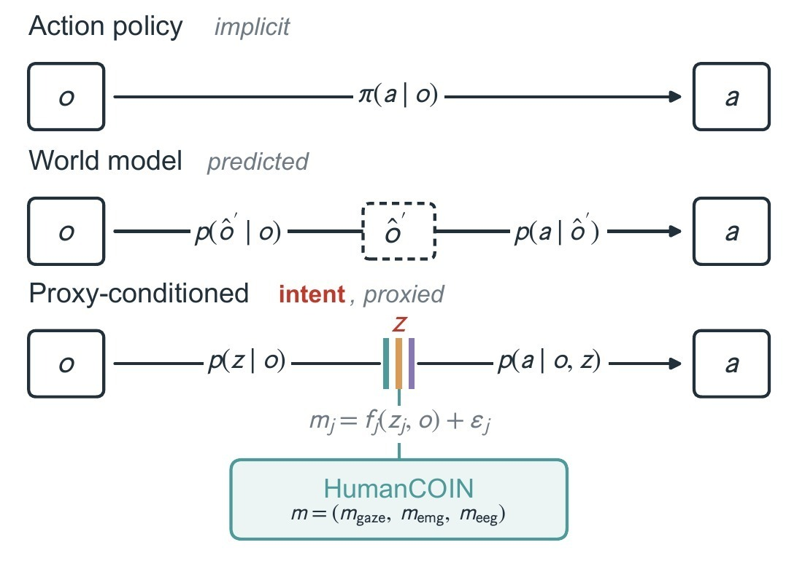
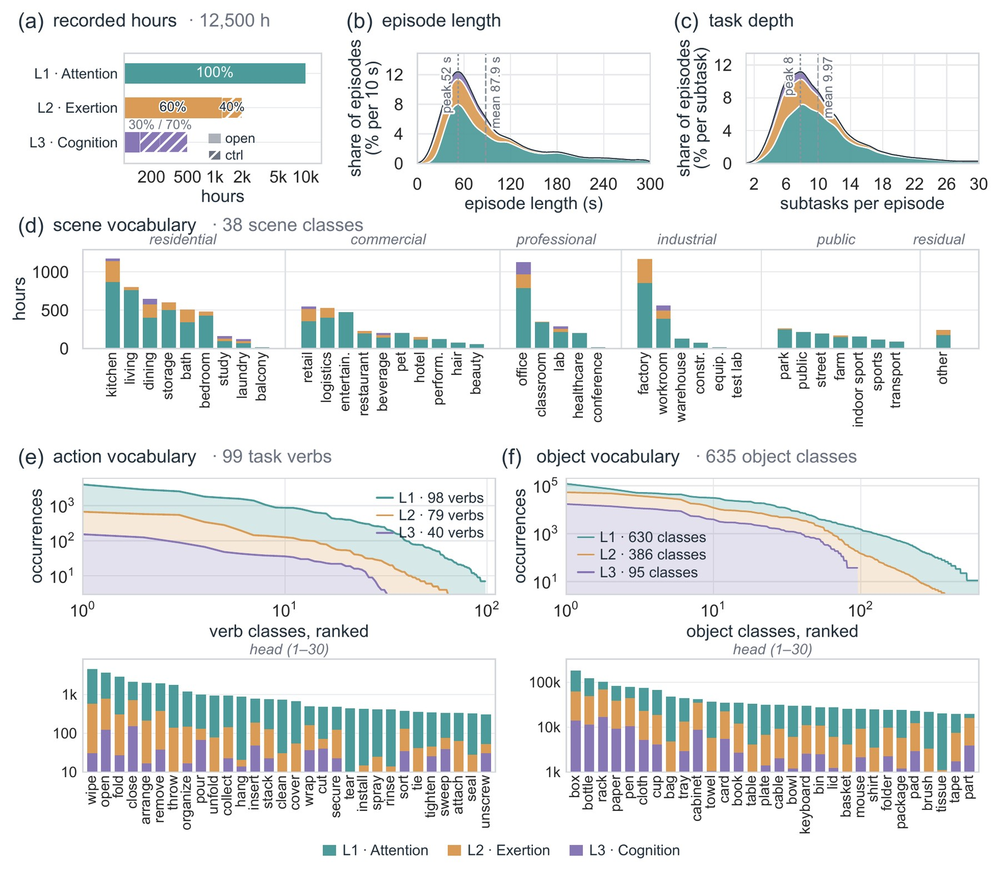
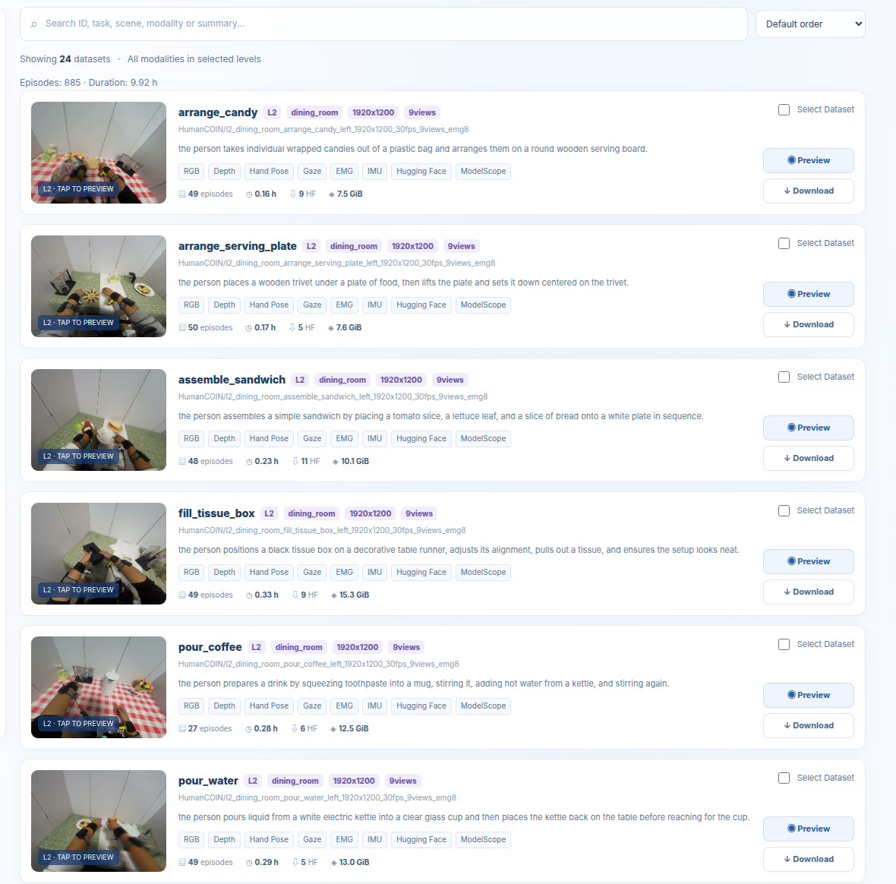
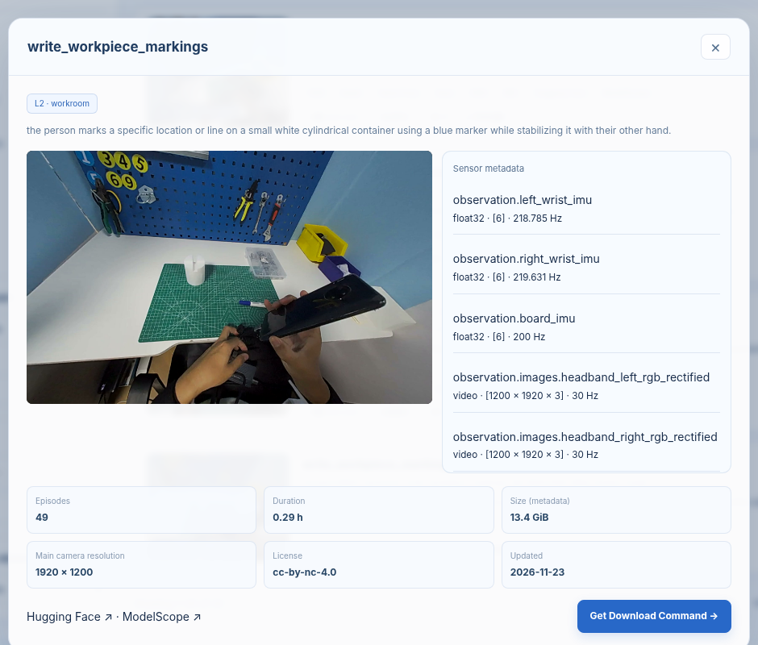
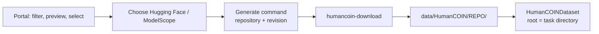
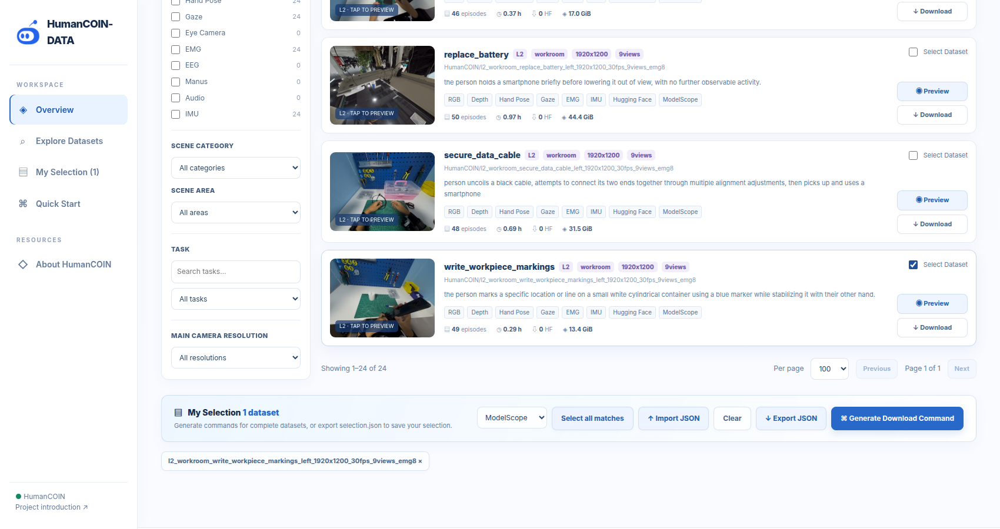
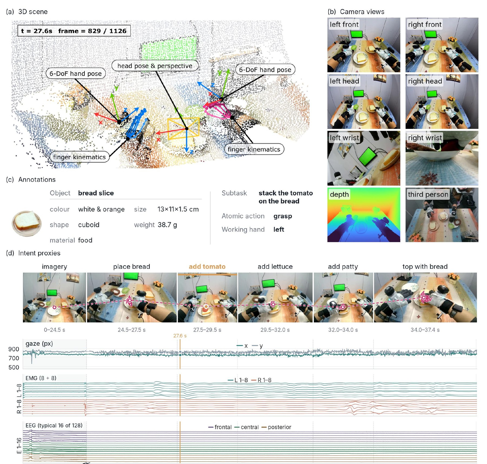
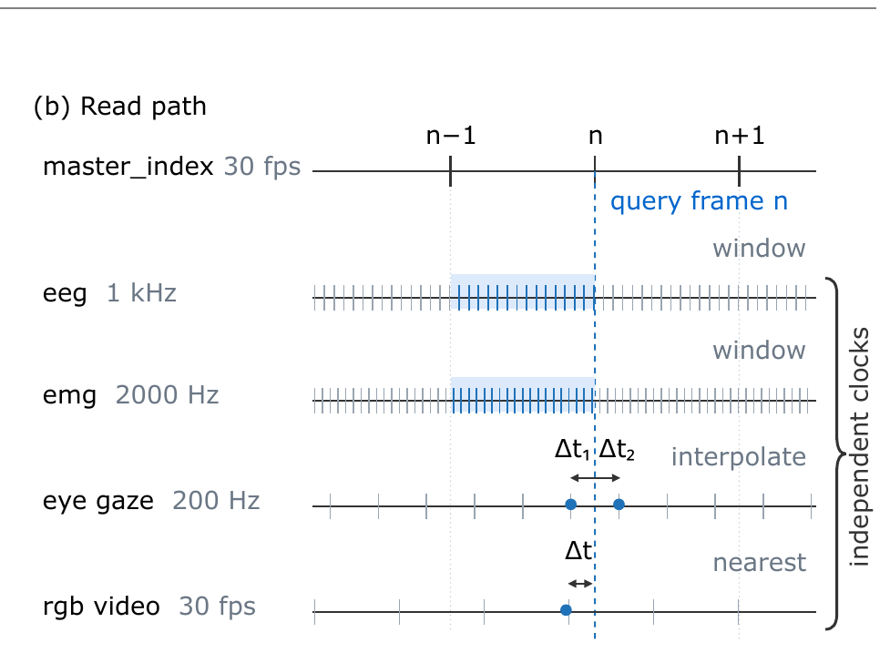
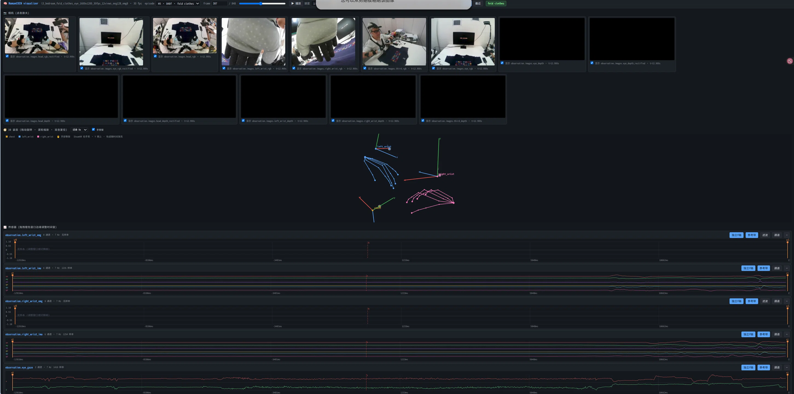
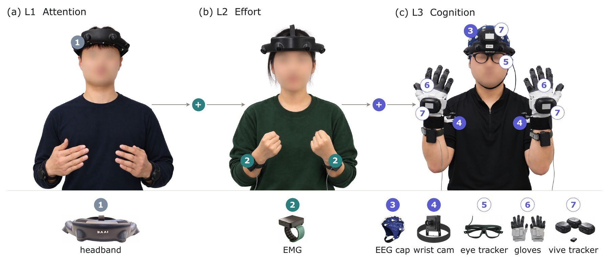

# HumanCOIN

<p align="center">
  
</p>

**A 12,500-hour egocentric manipulation dataset that records the signals behind the action — gaze, surface EMG and EEG — at three measurement depths, on one task ontology and one time base.**

<p align="center">
  <a href="https://flagopen.github.io/HumanCOIN/">Project page</a> ·
  <a href="https://arxiv.org/abs/2611.26434">Paper (arXiv:2611.26434)</a> ·
  <a href="https://flagopen.github.io/HumanCOIN-DataManager/">Data portal</a>
</p>

> 📖 中文文档：[README_zh-CN.md](README_zh-CN.md)

---

## Contents

- [What is HumanCOIN?](#what-is-humancoin)
- [Quick start](#quick-start)
- [Download data](#download-data)
- [What is in the data](#what-is-in-the-data)
- [On disk](#on-disk)
- [Reading and alignment](#reading-and-alignment)
- [Visualization](#visualization)
- [Using the data: default frames and intent proxies](#using-the-data-default-frames-and-intent-proxies)
- [How the data was collected](#how-the-data-was-collected)
- [Comparison with other datasets](#comparison-with-other-datasets)
- [Recording your own streams](#recording-your-own-streams)
- [Citation and license](#citation-and-license)
- [Acknowledgements](#acknowledgements)
- [Collaborating institutions](#collaborating-institutions)

---

## What is HumanCOIN?

Most egocentric datasets record an observation–action pair: what the camera saw and how the hands moved. A policy trained on that pair learns `π(a | o)` and compresses the operator's intent into its weights; a world model predicts the next observation, but not the state that produced the action. When the policy fails, the data offers no way to tell whether the target was wrong, the grip force was misjudged, or an error signal was missed.

HumanCOIN records that middle. Every episode carries three **wearable proxies for intent**, sampled along the pathway from decision to effect:

- **gaze** — where attention lands before the hand moves;
- **surface EMG** — how the forearm loads grip force before contact;
- **scalp EEG** — what the cortex prepares before the motor command.

The proxies are not ground-truth intent. They are lossy measurements of it, and the corpus is designed so that a model can learn `p(a | o, m)` from `m = (m_gaze, m_emg, m_eeg)` and compare it with `p(a | o)`. This distinction matters when you report results: HumanCOIN provides the middle as *measurements and estimates*, not as a latent label.

### A formal view

Let `o` be the observation, `a` the action, and `z` the operator's latent intent. The standard policy marginalises `z` away:

$$
p(a \mid o) = \int p(a \mid o, z)\, p(z \mid o)\, \mathrm{d}z .
$$

HumanCOIN does not attempt to observe `z` directly. It records a vector of proxies along the intent pathway,

$$
m_j = f_j(z_j, o) + \varepsilon_j, \qquad j \in \{\mathrm{gaze},\ \mathrm{emg},\ \mathrm{eeg}\},
$$

where `f_j` is a lossy, sensor-specific readout and `ε_j` is noise; `m` is not a sufficient statistic for `z`. The supervision the corpus supports is therefore a proxy-conditioned policy,

$$
p(a \mid o, m),
$$

together with a proxy model `p(m | o)`. The corpus supports two separate supervised problems:

$$
\max_\phi\ \mathbb{E}_{(o,m)}\left[\log p_\phi(m \mid o)\right],
\qquad
\max_\theta\ \mathbb{E}_{(o,m,a)}\left[\log p_\theta(a \mid o, m)\right].
$$

The first learns a proxy model wherever `m` is recorded; the second learns a policy wherever actions or action labels are available. Keeping them separate is the point of the tier design: a shallow tier can supply `p(m | o)` supervision without a robot, while L3 supplies the paired `(o, m, a)` needed for the policy.

The scientific question is whether the proxies carry information about the action beyond the observation. The quantity of interest is the conditional mutual information

$$
I(a; m \mid o) = \mathbb{E}[\log p(a \mid o, m) - \log p(a \mid o)],
$$

which is non-negative in theory and must be estimated from held-out data in practice: a positive estimate means `m` adds information, a value indistinguishable from zero means intent is redundant with observation for the task at hand. The controlled L3 subset adds measured gaze, pose and finger kinematics `y` as reference targets for the estimated proxies, but `y` is a reference measurement, not ground truth for `z`.

<p align="center">
  
  <br>
  <sub>An action policy folds intent into its weights; a world model predicts the future; HumanCOIN records proxies for the intent itself. Figure from the paper.</sub>
</p>

### Three tiers

The corpus is a ladder, not three unrelated datasets: each tier inherits every proxy of the tier below and adds one more. Hours decrease with signal depth because the instruments get more demanding.

| Tier | Hours | Added intent proxy | Typical streams | Setting | Scenes |
|------|-------|--------------------|-----------------|---------|--------|
| **L1 · Attention** | 10,000 | Gaze estimated from headband video (30 Hz) | 2–6 head cameras (20–60 fps), depth, 6-DoF/body/hand pose | Open, unscripted everyday activity | 38 classes |
| **L2 · Exertion** | 2,000 | Bilateral surface EMG, 8 channels per arm at 2 kHz | Fixed 4-camera headband, 2 wrist views, EMG raw + denoised traces | Open setting, scripted and staged tasks | 21 classes |
| **L3 · Cognition** | 500 | EEG: 128 channels at 1 kHz (controlled) or 32/8 channels at 250 Hz (open) | 4 head + 2 wrist + eye camera + third-person views, eye tracker, 3×6-DoF trackers, hand skeleton | ≈350 h controlled desk + ≈150 h open | 9 classes |

L1 records no EMG or EEG; L2 adds EMG; L3 adds EEG and, in its controlled subset, direct measurements of gaze, head/wrist pose and finger kinematics. Those direct measurements are the **reference** against which the estimates used in the shallower tiers can be scored — not ground truth for intent itself.

### At a glance

| Axis | Value |
|------|-------|
| Scale | 12,500 h · 1.35 B master frames at 30 fps · collected at 6 sites |
| Scenes | 38 classes in 5 zones (residential, commercial, professional, industrial, public) + 1 residual |
| Tasks | 99 task verbs + 46 motion verbs; about 10 subtask stages per episode |
| Objects | 635 annotated object classes; 839 measured instances with shape, size, weight, material and colour |
| Signals | multi-view RGB, metric depth and point clouds, 6-DoF head/wrist pose, finger kinematics, gaze, sEMG, EEG, IMU, microphone |
| Episodes | mean 88 s (L1 101 s, L2 65 s, L3 60 s); density peak at 52 s |
| Format | LeRobot-style: one Parquet per stream, a master index, MP4 video, and WAV audio where present; each release declares its `codebase_version` in `meta/info.json` |
| License | data CC BY-NC 4.0; code Apache-2.0 |

<p align="center">
  
  <br>
  <sub>The corpus in one view: tier hours, episode length, task depth, 38 scene classes, 99 task verbs and 635 object classes. Figure from the paper.</sub>
</p>

<p align="center">
  
  <br>
  <sub>One head-camera frame per scene class, grouped by zone. Figure from the paper.</sub>
</p>

**Catalog vs. corpus.** 12,500 h is the full documented corpus. Data is released in batches, so the live catalog is smaller and grows over time — in the 2026-11 snapshot the portal listed 689 repositories, 12,119 episodes and roughly 530 h (about 7.5 TB). Always use the counters and dataset cards in the [data portal](https://flagopen.github.io/HumanCOIN-DataManager/) as the source of truth for what can be downloaded today. For access to later batches, the portal asks you to email `humancoin@163.com`.

---

## Quick start

From zero to a decoded frame of real HumanCOIN data in about five minutes. The example is a 65 MB, 29 s L1 repository; any other repository from the portal works the same way.

### 1. Install

```bash
pip install -U "humancoin>=0.1.1"
```

Python 3.10–3.13. The package pins LeRobot 0.3.3 and brings the downloader, dataset reader and both visualizers.

### 2. Choose a dataset and download it

Open the **[HumanCOIN DataManager](https://flagopen.github.io/HumanCOIN-DataManager/)**, filter by tier, modality, scene, task or resolution, select one or more repositories, choose Hugging Face or ModelScope, then click **Generate Download Command**. The portal fills in the repository name and the revision for the selected source:

```bash
humancoin-download --hub huggingface \
  --datasets 'HumanCOIN/l1_study_room_fill_task_1920x1456_30fps_2views' \
  --revision 'b1b5d76c9a06d100733f4e4eac1a3e5f8942dfba' \
  --target-dir ./data --max-workers 8
```

Files land in `./data/HumanCOIN/<repository-name>/`. An L1 repository groups one or more `<task-name>/` recordings, and each task directory is a complete dataset; L2 and L3 repositories are flat and can be loaded from the repository root. Most datasets are gated: request access on the dataset's Hugging Face page once, then authenticate in the same terminal before downloading:

```bash
hf auth login
hf auth whoami
```

For ModelScope, request access there, create an access token with the same account and export `MODELSCOPE_TOKEN`; see [ModelScope: access and token](#modelscope-access-and-token).

> **Trying the deepest tier instead?** `l3_bedroom_fold_clothes_eye_1600x1200_30fps_12views_eeg128_emg8` is a 28 s, 188 MB L3 episode with 128-channel EEG and 8-channel EMG — the cheapest way to see the full sensor set.

### 3. Read one frame

```python
from pathlib import Path
from humancoin import HumanCOINDataset

REPO = "HumanCOIN/l1_study_room_fill_task_1920x1456_30fps_2views"
repo_dir = Path("data") / REPO
task_dir = repo_dir if (repo_dir / "meta/info.json").is_file() else next(
    p for p in sorted(repo_dir.iterdir()) if (p / "meta/info.json").is_file()
)

ds = HumanCOINDataset(repo_id=REPO, root=task_dir)

print(task_dir.name)                        # l1_study_room_fill_box_<hash>
print(len(ds), "frames @", ds.fps, "fps")   # 882 frames @ 30.0 fps
frame = ds[0]

print(frame["observation.images.head_left_rectified"].shape)  # (3, 1456, 1920)
print(frame["observation.head_pose"].shape)                   # (7,)
print(frame["eye_gaze_predict"].shape)                        # (2,)
print(frame["task"])                                          # task string
```

Every key in `frame` comes from one episode of one task directory. `ds[i]` first looks up the i-th master-clock timestamp, then resolves each stream around that time; no stream is pre-resampled. For a flat L2/L3 repository, pass the repository root as `root` directly.

### 4. Look at it

```bash
# point the viewer at the task directory printed above (for a flat L2/L3 repo, use the repo root)
TASK=$(dirname "$(dirname "$(find "data/HumanCOIN/l1_study_room_fill_task_1920x1456_30fps_2views" -path '*/meta/info.json' | head -n 1)")")
humancoin-visualize-web "$TASK"
```

The browser viewer opens on `http://127.0.0.1:8000` and lets you scrub frames, drag the time window, inspect every stream and filter EEG/EMG. See [Visualization](#visualization) for the desktop viewer and controls.

---

## Download data

There are two supported ways to get the corpus: the portal with the `humancoin-download` command it generates, or the same command typed by hand. The portal is the recommended route because it resolves names, revisions, sizes and access requirements for you.

### The download portal

The **[HumanCOIN DataManager](https://flagopen.github.io/HumanCOIN-DataManager/)** is the public catalog for released data.

<p align="center">
  
  <br>
  <sub>Explore Datasets: search and compare released repositories; each card exposes its sensor set, size and Preview/Download actions.</sub>
</p>

<p align="center">
  
  <br>
  <sub>A dataset card: task description, per-stream metadata, episode count, duration, size, license, and the <b>Get Download Command</b> entry point.</sub>
</p>

1. **Browse.** The overview reports published repositories, episodes, hours and Hugging Face downloads. **Explore Datasets** filters by data level (L1/L2/L3), modality (RGB, depth, hand pose, gaze, eye camera, EMG, EEG, glove/Manus, audio, IMU), scene, task and main-camera resolution.
2. **Preview.** A dataset card shows the task description, episodes, duration, size, resolution, license and the exact stream list. Full video previews stream from Hugging Face, so gated repositories need access first.
3. **Select.** Tick one or more complete repositories. The selection is kept in browser storage and can be exported/imported as `selection.json`, which is useful for sharing a reproducible subset.
4. **Choose a source.** Hugging Face or ModelScope. A repository may exist on one hub only; the portal tells you which download commands are available.
5. **Generate the command.** The generated command selects the revision shown on the card — a commit on Hugging Face, usually `master` on ModelScope — so the download follows the catalog snapshot:



```bash
humancoin-download --hub huggingface \
  --datasets 'HumanCOIN/<repository>' \
  --revision '<commit-hash>' \
  --target-dir ./data --max-workers 8
```

Run it in the same terminal where you authenticated. `--dry-run` prints the destination and include/exclude patterns without downloading anything.

### Repository names

The name encodes enough to browse without opening every card:

```text
l1_study_room_fill_task_1920x1456_30fps_2views
│  │          │    │        │      │     └─ 2 released camera views
│  │          │    │        │      └─ frame rate
│  │          │    │        └─ main camera resolution
│  │          │    └─ task
│  │          └─ scene
│  └─ tier
```

L2 and L3 names add the sensor kit, for example `..._9views_emg8` or `..._12views_eeg128_emg8`. Scene, task and view count are also searchable in the portal, so you rarely need to parse a name by hand.

### CLI reference

```bash
humancoin-download --help
# also available as: python -m humancoin.download --help
```

| Flag | Meaning |
|------|---------|
| `--hub {huggingface,modelscope}` | source hub (default `huggingface`) |
| `--datasets A B ...` | one or more repository names or `owner/name` IDs; `--ds_lists` is an alias |
| `--revision REV` | branch, tag or commit; the portal fills in the source-specific revision (a commit on Hugging Face, usually `master` on ModelScope) |
| `--target-dir DIR` | download root (default `~/.cache/huggingface/lerobot`); files go to `DIR/HumanCOIN/<name>` |
| `--max-workers N` | parallel file downloads (default 8) |
| `--include ...` / `--exclude ...` | relative-path globs for partial downloads |
| `--dry-run` | print the plan without downloading |
| `--token TOKEN` | access token; prefer `HF_TOKEN` / `MODELSCOPE_TOKEN` (`MS_TOKEN` also accepted) |
| `--namespace NAME` | namespace for bare names (default `HumanCOIN`) |

Examples:

```bash
# several repositories in one invocation
humancoin-download --hub huggingface \
  --datasets 'HumanCOIN/l1_study_room_fill_task_1920x1456_30fps_2views' \
             'HumanCOIN/l3_bedroom_fold_clothes_eye_1600x1200_30fps_12views_eeg128_emg8' \
  --target-dir ./data --max-workers 8

# inspect the storage plan before committing disk
humancoin-download --datasets 'HumanCOIN/l1_study_room_fill_task_1920x1456_30fps_2views' \
  --target-dir ./data --dry-run

# flat L2/L3 repository: metadata and calibration only (small, but not loadable)
humancoin-download --datasets 'HumanCOIN/<repository>' --target-dir ./data \
  --include "meta/*" "calibrations/*"
```

Re-running a download is safe: the hub SDK reuses files already present, so an interrupted transfer resumes. A failure on one repository does not stop the others; the process exits nonzero if any of them failed.

### ModelScope: access and token

ModelScope mirrors the catalog. For a gated repository:

<p align="center">
  
  <br>
  <sub>Select one or more complete repositories, switch the source to <b>ModelScope</b>, then click <b>Generate Download Command</b>. The same bar exports <code>selection.json</code> for later import.</sub>
</p>

1. Request access on the ModelScope dataset page with the account you will use for downloading.
2. Create a [ModelScope access token](https://modelscope.cn/my/myaccesstoken) from that same account.
3. In the Bash terminal you will use for the download, export the token interactively so it does not land in shell history:

```bash
read -rsp 'ModelScope Token: ' MODELSCOPE_TOKEN
printf '\n'
export MODELSCOPE_TOKEN
```

4. Run the command generated by the portal. ModelScope commands use `--hub modelscope` and usually `--revision 'master'`:

```bash
humancoin-download --hub modelscope \
  --datasets 'HumanCOIN/l2_workroom_write_workpiece_markings_left_1920x1200_30fps_9views_emg8' \
  --revision 'master' \
  --target-dir ./data --max-workers 8
```

Files land in `./data/HumanCOIN/<repository>/`, with the same task-directory layout as the Hugging Face path. `--dry-run`, `--include`/`--exclude` and the portal's `selection.json` work the same for both hubs; only the hub and revision differ. The downloader reads `MODELSCOPE_TOKEN` or `MS_TOKEN`; `--token` also works, but exporting avoids pasting the secret into a command that may be saved. `master` is a mutable branch: pin a commit or tag when you need byte-identical reproducibility.

### Access, disk and verification

- **Gated data.** Most HumanCOIN repositories are gated (`auto` approval). Open the dataset page on Hugging Face, request access, wait for approval, then `hf auth login`. A 401/403 from the downloader usually means the approval is missing or the token belongs to a different account.
- **ModelScope.** See [ModelScope: access and token](#modelscope-access-and-token) for requesting access, exporting `MODELSCOPE_TOKEN` and running the portal command.
- **Disk.** Sizes vary widely: the quick-start L1 example is 65 MB, while L2/L3 repositories are multi-GB and the largest exceed 60 GB. The full published catalog is roughly 7.5 TB. Check the size on the card before selecting a tier; `df -h` is cheaper than a failed download.
- **Verify.** A flat L2/L3 repository has `meta/info.json` at its root; an L1 repository has one `<task>/meta/info.json` per recording. In either case a complete task directory also has at least one `data/chunk-*/episode_*/master_index.parquet`. If `meta/` exists but no `data/`, the download was partial or is still running.

---

## What is in the data

One episode is a time-aligned record of a person doing a task in a real scene, with the body, the scene and the signals behind the action all placed in one coordinate frame and on one clock.

<p align="center">
  
  <br>
  <sub>One controlled L3 episode at t = 27.6 s. (a) metric point cloud with head pose, hand skeletons and 6-DoF wrist poses; (b) eight synchronized views plus depth; (c) step and object annotation; (d) gaze, EMG and EEG of the same interval on one time axis. Figure from the paper.</sub>
</p>

### Views and geometry

- **Head cameras.** L1 uses 14 third-party headband models from 13 vendors: 2–6 lenses, 20–60 fps, from 512×512 rectified to 3840×1200. L2 and L3 use a head-mounted multi-camera rig, typically four lenses at 1920×1200 and 30 fps; the front pair is hardware-synchronized. A released stream may be downscaled (for example, the L3 head view ships at 640×360 in some repositories), so always read the shape from `info.json`.
- **Wrist and third-person cameras.** L2 adds two wrist views; L3 adds two 640×480 wrist cameras, a 1600×1200 eye-tracker scene camera, and — in the controlled subset — a third-person RGB-D view. L3 repositories can carry 5–12 released views depending on the kit.
- **Depth and point clouds.** Depth is reconstructed from the front stereo pair with FoundationStereo, stored with the intrinsics that produced it, and projected into per-frame point clouds. Camera views are released raw and rectified where the release provides both; rectification parameters ship with the episode.
- **Pose and hands.** Head, both wrists and the chest share one metric frame: `+x` left, `+y` up, `+z` forward; translations in millimetres, joint angles in degrees. A pose stream is stored either as 7 values (position + quaternion) or 6 values (position + Euler angles); read its `names` to know which. In the controlled L3 subset, three 6-DoF trackers (≈800 Hz device rate) and 20-node gloves measure pose and 20 joint angles per hand; at L1, L2 and open L3 the same quantities are estimated from video.

### Intent proxies

| Proxy | Stream (typical) | Rate | Measured or estimated |
|-------|------------------|------|-----------------------|
| Gaze | `observation.eye_gaze` (controlled L3); `eye_gaze_predict` (L1, L2, open L3) | 200 Hz measured; 30 Hz estimated | measured in controlled L3, predicted elsewhere |
| Surface EMG | `observation.left_wrist_emg` and its raw/denoised variants (`*_raw`, `*_denoise`; names vary) | 2 kHz, 8 channels per arm | measured from L2 onward |
| EEG | `observation.eeg_raw`, `observation.eeg_denoise` (names vary by release) | 1 kHz × 132 columns (128-channel cap) controlled; 250 Hz × 32/8 open | measured at L3 |

Gaze is a pixel coordinate in the scene camera (controlled L3) or in the rectified head view (everywhere else). EMG is released as raw and denoised traces; derive an envelope if your analysis needs one. EEG is released as acquired, filtered, and repaired where available; the exact column set is listed in each repository's `meta/info.json`.


### Annotations

Annotation is step-level, not just clip-level. Every step carries a sentence, a **task verb** (99 classes: wipe, open, fold, close, arrange…), a working hand, the objects it touches, and a set of **motion verbs** (46 classes, on average 2.5 per step: pick, place, move, grasp…). At L2 and L3 the object record can include measured shape, size, weight, material and colour (availability varies by release), so EMG activity can be read against object attributes rather than a guessed label.

Episodes also carry timed task stages, key events, state changes, and — in controlled L3 — phase markers for the imagery and execution segments. The annotation ships as structured JSON next to the episode, and is exported into LeRobot language columns for training.

---

## On disk

A **task directory** is a self-contained LeRobot-style dataset. A repository holds either one task directory at its root (L2/L3) or several task directories (L1); the exact stream set depends on the tier and kit, the layout does not.

```text
l1_study_room_fill_task_1920x1456_30fps_2views/     # repository
├── README.md
├── preview.jpg
├── portal.yaml
└── l1_study_room_fill_box_<hash>/                  # task directory = dataset root
    ├── data/
    │   └── chunk-000/
    │       └── episode_000000/
    │           ├── master_index.parquet            # timestamp | frame_index | episode_index | index | task_index
    │           ├── observation.head_pose.parquet
    │           ├── observation.hand_left_points.parquet
    │           ├── observation.body_pose.parquet
    │           └── ...                             # one Parquet per signal
    ├── videos/
    │   └── chunk-000/
    │       ├── observation.images.head_left_rectified/
    │       │   └── episode_000000.mp4
    │       └── ...
    ├── audios/                                     # when the unit records a microphone
    │   └── chunk-000/...
    ├── calibrations/
    │   ├── dataset_manifest.json
    │   ├── rectify_params.yaml
    │   └── source_camera_calibration.json
    ├── annotation/
    │   └── episode_000000_structured.json
    └── meta/
        ├── info.json                               # features, shapes, fps, windows, path templates
        ├── episodes.jsonl
        ├── episodes_stats.jsonl
        ├── tasks.jsonl
        ├── readme.json                             # per-task release summary
        ├── collect_info.jsonl                      # when present: collector, hardware, scene, objects
        ├── alignment_check.jsonl                   # when present: per-stream timing audit
        └── qc_reports.jsonl                        # when present: quality-control findings
```

L2 and L3 repositories skip the extra level: `data/`, `videos/` and `meta/` sit directly under the repository root. `meta/info.json` is the file that tells you which shape you have — if it is not at the repository root, descend into a child directory that contains it. The exact metadata set varies by release: `info.json`, `episodes.jsonl`, `episodes_stats.jsonl`, `tasks.jsonl` and `readme.json` are common; L2/L3 can add `collect_info.jsonl`, `alignment_check.jsonl`, `calibrations.jsonl`, `source_sessions.jsonl` and `qc_reports.jsonl`.

Every signal is one Parquet file on its own time base:

```text
timestamp (float64) | episode_index (int64) | channel_0 ... channel_D
```

- `timestamp` is seconds from the start of the recording, stored as recorded. Nothing is snapped to the master grid, so native rates, device jitter and gaps survive in the file.
- `master_index.parquet` is the fixed-rate spine (30 fps in the released data). Reading `ds[i]` starts here and resolves every other stream from its own timestamps.
- Pixels are not stored in Parquet. RGB views are H.264 MP4 at 30 fps; the matching `observation.images.*.parquet` lists the timestamp of every frame. Raw and rectified encodings live side by side.
- Audio, where present, is 16 kHz mono PCM WAV plus a Parquet table recording the sample count contributed by each master frame.
- Calibration (camera intrinsics and distortion, rectification parameters, tracker-to-frame transforms, eye-tracker calibration) ships with the episode, so geometry can be re-derived instead of accepted.
- Names are literal: `*_raw` is the stream as acquired, `eeg_denoise` / `*_emg_denoise` (or `.denoised`) is the cleaned trace, and an EMG envelope can be derived from the cleaned trace.

A repository may contain more metadata or a different subset of streams than the sketch above. The authoritative feature list is always:

```python
for key, spec in ds.meta.features.items():
    if key in {"timestamp", "frame_index", "episode_index", "index", "task_index"}:
        continue
    print(f"{key:48s} {spec.get('dtype', ''):8s} {tuple(spec.get('shape', ()))}")
```

---

## Reading and alignment

### Master clock and windows

The dataset's frame rate defines a **master clock**. Frame `i` has timestamp `t = i / fps` in the episode's master time base. Every other stream keeps its native timestamps; when you read `ds[i]`, each feature is resolved around `t` according to its `window`:

| `window` | Returned value | Typical use |
|----------|----------------|-------------|
| `None` (default) | one nearest sample | 30 Hz state, RGB frame, one audio chunk |
| `"interpolate"` | linear interpolation at `t` | mid-rate pose or trajectory |
| `(start, end)` | all samples in `(t + start, t + end]`, plus `"<key>_timestamps"` | gaze, EMG, EEG, high-rate IMUs |

The window is a read-time decision stored in `meta/info.json`, so the same repository can be consumed at different temporal resolutions without rewriting data. Override it per feature when constructing the dataset:

```python
ds = HumanCOINDataset(
    repo_id="HumanCOIN/l3_bedroom_fold_clothes_eye_1600x1200_30fps_12views_eeg128_emg8",
    root="data/HumanCOIN/l3_bedroom_fold_clothes_eye_1600x1200_30fps_12views_eeg128_emg8",
    window_overrides={
        "observation.eye_gaze": (-1 / 30, 0.0),
        "observation.eeg_denoise": (-1 / 30, 0.0),
        "observation.left_wrist_emg": (-1 / 30, 0.0),
    },
)

item = ds[100]
print(item["timestamp"])                          # tensor(3.3333)
print(item["observation.eye_gaze"].shape)         # ~[6, 2]
print(item["observation.eeg_denoise"].shape)      # ~[33, 132]
print(item["observation.left_wrist_emg"].shape)   # ~[66, 8]
print(item["observation.images.head_rgb"].shape)  # [3, 360, 640]
print(item["action"].shape)                       # [58]
```

> **Check the keys before looping.** Feature names can shift slightly between releases (for example `observation.left_wrist_emg` in the card versus `*_emg_raw` / `*_emg_denoise` in the Parquet files). Print `ds.meta.features` for the exact keys of the checkout you downloaded.

<p align="center">
  
  <br>
  <sub>Read path (paper Fig. 6b). A fixed-rate master index defines frame <code>n</code>; each stream is resolved from its own clock — a window for EEG/EMG, interpolation for gaze, nearest sample for RGB — without resampling the data. Figure from the paper.</sub>
</p>

The first time an episode is touched, each stream's Parquet is loaded and cached; subsequent frames from that episode are cheap. Video frames are decoded on demand. Sequential access is therefore much faster than random access across episodes, and `num_workers > 0` multiplies memory because each worker gets its own cache.

### Index columns and task labels

`item` also contains `timestamp`, `frame_index`, `episode_index`, `index`, `task_index` and `task`. `index` is global across the repository; `task` is the string for the current frame. In L3, `observation.state` and `action` are 58-D fused vectors: both wrist poses and the head pose (18 values) plus 40 finger joint angles.

### Subsets, offsets and delta timestamps

```python
# load only selected episodes
ds = HumanCOINDataset(repo_id=..., root=..., episodes=[0, 2])

# stack one feature over offsets around every queried frame
ds = HumanCOINDataset(
    repo_id=..., root=...,
    delta_timestamps={"observation.head_pose": [-0.5, 0.0, 0.5]},
)
item = ds[100]
print(item["observation.head_pose"].shape)   # [3, 7]
```

`delta_timestamps` is intended for short temporal context. The current implementation applies one offset list to the features being stacked, so pass a single offset list when you rely on per-feature alignment.

### Depth, audio and missing data

- **Depth.** When metadata marks `video.is_depth_map` and declares an `(H, W, 1)` shape, the view is decoded as `(1, H, W)` in its native sample format (for example `uint16` for `gray12le`), without RGB conversion or `/255`. Some releases store depth as `(H, W)`; check `shape` and `video.is_depth_map` in `info.json` before treating a depth stream as RGB. Units and invalid values are those of the stored data.
- **Audio.** Nearest-window reads return one whole chunk; a `(start, end)` window returns a sample-precise slice across chunk boundaries, concatenated. Chunks are labelled by their first sample and advance at exactly `1 / sample_rate`.
- **Missing samples.** Lost tracking, invalid gaze and dead EEG channels appear as `NaN` or empty windows rather than fabricated values. High-rate windows can legitimately vary in length by one or two samples because timestamps are not snapped to the grid.

### Batching

Window features are variable-length, so PyTorch's default collate will fail. Either pad/crop in the model or use a list collate:

```python
from torch.utils.data import DataLoader

def collate(batch):
    return {key: [b[key] for b in batch] for key in batch[0]}

loader = DataLoader(ds, batch_size=4, shuffle=True, collate_fn=collate, num_workers=0)
```

---

## Visualization

### Portal preview

The [data portal](https://flagopen.github.io/HumanCOIN-DataManager/) is the fastest way to look at a repository before downloading it: each card opens a preview with the task description, poster frame, sensor list, episode count, duration, size and resolution. Full video previews are streamed from Hugging Face, so gated repositories require access.

### Browser viewer (recommended for real data)

```bash
# DATASET_ROOT is a task directory; for a flat L2/L3 repository it is the repository root
humancoin-visualize-web "<dataset-root>"
# choose a port or bind address if needed
humancoin-visualize-web "<dataset-root>" --port 8080 --no-browser
```

The viewer serves a local page with synchronized camera panels, per-stream signal strips, a draggable time window, a 3D pose/hand-skeleton view where those streams exist, and — when the release includes an impedance snapshot — a color-coded EEG electrode grid. On EEG and EMG strips you can apply a zero-phase Butterworth high-pass/low-pass and a comb notch at the line frequency and its harmonics; the same filter is available over the API, for example `filt=observation.eeg_denoise:hp=0.5,lp=40,notch=50`. The filter is a display/analysis convenience, not a replacement for a documented preprocessing pipeline.

<p align="center">
  
  <br>
  <sub>The browser viewer on a real L3 episode (<code>l3_bedroom_fold_clothes_eye_1600x1200_30fps_12views_eeg128_emg8</code>, frame 381/848): the full raw/rectified camera wall, the 3D head/wrist/hand-skeleton view, and the EMG, IMU and gaze strips on the master timeline.</sub>
</p>

### Desktop viewer

```bash
humancoin-visualize "<dataset-root>" --episode 0
```


| Key | Action |
|-----|--------|
| `space` | play / pause |
| `←` `→` | previous / next frame |
| `↑` `↓` | faster / slower playback |
| `w` `s` | widen / shrink the time window |
| `q` / `Esc` | quit |

---

## Using the data: default frames and intent proxies

`ds[i]` already returns everything needed for a per-frame batch: the default observation, state and action, plus the proxy windows configured in `info.json`. There is no need to build a custom window dataset first.

| Key | Typical shape | Meaning |
|-----|---------------|---------|
| `observation.images.head_rgb` | `(3, H, W)` | camera frame |
| `observation.state` | `(58,)` | fused head/wrist pose + 40 finger joints |
| `action` | `(58,)` | fused action target |
| `observation.eye_gaze` | `(N_g, 2)` | gaze window in pixels |
| `observation.left_wrist_emg` | `(N_e, 8)` | EMG window, 8 channels |
| `observation.eeg_denoise` | `(N_c, 132)` | EEG window, 132 channels |

The proxy windows are variable-length, so batching only needs padding and a mask — not resampling or manual temporal stacking. Print `ds.meta.features` first: some releases expose EMG under a different suffix (`*_raw` / `*_denoise`).

### Batch the default fields

```python
from pathlib import Path

import torch
import torch.nn as nn
import torch.nn.functional as F
from torch.utils.data import DataLoader, Subset

from humancoin import HumanCOINDataset

REPO = "HumanCOIN/l3_bedroom_fold_clothes_eye_1600x1200_30fps_12views_eeg128_emg8"
ds = HumanCOINDataset(
    repo_id=REPO,
    root=Path("data") / REPO,
    tolerance_s=1 / 30,          # L3 videos can be one frame off the master grid
)

PROXY_KEYS = (
    "observation.eye_gaze",
    "observation.left_wrist_emg",
    "observation.eeg_denoise",
)


def collate(batch):
    out = {
        "observation.images.head_rgb": torch.stack(
            [b["observation.images.head_rgb"] for b in batch]),
        "observation.state": torch.stack([b["observation.state"] for b in batch]),
        "action": torch.stack([b["action"] for b in batch]),
    }
    for key in PROXY_KEYS:
        seqs = [b[key] for b in batch]
        length = max(len(seq) for seq in seqs)
        dim = seqs[0].shape[-1]
        padded = torch.zeros(len(seqs), length, dim)
        mask = torch.zeros(len(seqs), length, dtype=torch.bool)
        for i, seq in enumerate(seqs):
            if len(seq):
                padded[i, :len(seq)] = seq
                mask[i, :len(seq)] = True
        out[key] = padded
        out[f"{key}_mask"] = mask
    return out


loader = DataLoader(
    Subset(ds, range(1, len(ds))),   # skip frame 0, whose video may start one tick late
    batch_size=8,
    shuffle=True,
    collate_fn=collate,
)
```

### Demo: add gaze, EMG and EEG to the action head

This small model is deliberately simple: one image encoder, one linear state encoder, one encoder per proxy stream, masked mean pooling over each window, and an action head. It is enough to show how gaze, EMG and EEG enter the same forward pass as `o` and `a`.

```python
class ProxyPolicy(nn.Module):
    def __init__(self, state_dim=58, action_dim=58, width=64):
        super().__init__()
        self.image = nn.Sequential(
            nn.Conv2d(3, 16, 5, stride=2, padding=2), nn.ReLU(),
            nn.Conv2d(16, 32, 3, stride=2, padding=1), nn.ReLU(),
            nn.AdaptiveAvgPool2d(1), nn.Flatten(),
            nn.Linear(32, width),
        )
        self.state = nn.Linear(state_dim, width)
        self.gaze = nn.Linear(2, width)
        self.emg = nn.Linear(8, width)
        self.eeg = nn.Linear(132, width)
        self.head = nn.Sequential(
            nn.Linear(width * 5, width * 2), nn.GELU(),
            nn.Linear(width * 2, action_dim),
        )

    @staticmethod
    def masked_mean(x, mask):
        x = x * mask.unsqueeze(-1)
        return x.sum(1) / mask.sum(1, keepdim=True).clamp_min(1)

    def forward(self, batch):
        image = F.interpolate(
            batch["observation.images.head_rgb"],
            size=(128, 128), mode="bilinear", align_corners=False,
        )
        z_img = self.image(image)
        z_state = self.state(batch["observation.state"])
        z_gaze = self.masked_mean(
            self.gaze(batch["observation.eye_gaze"]),
            batch["observation.eye_gaze_mask"],
        )
        z_emg = self.masked_mean(
            self.emg(batch["observation.left_wrist_emg"]),
            batch["observation.left_wrist_emg_mask"],
        )
        z_eeg = self.masked_mean(
            self.eeg(batch["observation.eeg_denoise"]),
            batch["observation.eeg_denoise_mask"],
        )
        return self.head(torch.cat([z_img, z_state, z_gaze, z_emg, z_eeg], dim=-1))


device = "cuda" if torch.cuda.is_available() else "cpu"
model = ProxyPolicy().to(device)
optimizer = torch.optim.AdamW(model.parameters(), lr=1e-4)

for step, batch in enumerate(loader):
    batch = {key: value.to(device) for key, value in batch.items()}
    pred = model(batch)
    loss = F.mse_loss(pred, batch["action"])
    optimizer.zero_grad()
    loss.backward()
    optimizer.step()
    print(f"step {step}: loss={loss.item():.4f}")
    if step == 0:               # one step is enough to check the wiring
        break
```

On a real L3 episode this produces a finite loss for a single step; that only proves the shapes and gradients line up.

### Connecting to LeRobot Diffusion Policy

LeRobot's `DiffusionPolicy` consumes `observation.images.*`, `observation.state` and `action`, and builds its global conditioning from the image and state encoders. The stock `DiffusionConfig` has no first-class `gaze`/`emg`/`eeg` inputs. To use the proxies there, the smallest change is to fuse the three proxy embeddings into one vector and either:

- concatenate it to `observation.state` and widen the policy's state feature, or
- inject it as an extra global-conditioning token inside `DiffusionModel._prepare_global_conditioning`.

`lerobot-train` also expects a merged `LeRobotDataset` with dataset statistics; HumanCOIN's per-stream layout is not that format. A production pipeline therefore needs a small adapter or a materialised fixed-rate view. The demo above deliberately avoids pretending that `DiffusionPolicy` runs unchanged.

### Why this is not directly usable

- **The action is human, not robotic.** `action` is a 58-D fused pose-and-finger vector; a robot needs retargeting, a latent action space, or a different head.
- **One episode is not a dataset.** This is a plumbing test on a 28 s recording, not a trained policy.
- **No normalisation or evaluation.** Actions and proxies are used at raw scale; a real run needs statistics, a train/val split and task metrics.
- **Proxy keys vary.** Releases can expose `*_raw` / `*_denoise` or `left_wrist_emg` / `.denoised`; always read `ds.meta.features` and substitute the actual keys.
- **The windows are short by design.** A 33 ms gaze/EMG/EEG window is the default query, not necessarily the right temporal context for intent; window choice is a modelling decision.

### What the corpus is for

The interesting uses are one level up: pretraining multimodal representations on 12,500 h, learning proxy models `p(m | o)`, training intent-conditioned architectures `p(a | o, m)`, estimating gaze/hand pose where only video exists, and testing whether intent transports across tiers. A production training recipe is **not the focus of this project**; the corpus and its readers are. If you build a stronger baseline, a conversion script or a new architecture on top of it, community contributions and issues are welcome.

---

## How the data was collected

<p align="center">
  
  <br>
  <sub>The three kits. L1: third-party headbands. L2: a fixed four-camera headband plus bilateral EMG armbands. L3: the L2 kit plus EEG, wrist cameras and, in the controlled setting, eye tracker, gloves and 6-DoF trackers. Figure from the paper.</sub>
</p>

### Hardware configuration

| Tier | Stream | Device (example) | Native resolution / channels | Rate | Unit |
|------|--------|------------------|------------------------------|------|------|
| L1 | head RGB | third-party headbands: 14 units, 13 vendors, 2–6 lenses | 512×512–3840×1200 | 20–60 fps | RGB |
| L2 | head RGB | four-camera headband, hardware-synchronized front pair | 1920×1200 | 30 fps | RGB |
| L2/L3 | wrist RGB | JIERUIWEITONG FH868 | 640×480 (up to 1920×1080 in some L2 releases) | 30 fps | RGB |
| L3 | eye scene camera | Pupil Labs Neon | 1600×1200 | 30 fps | RGB |
| L3 | third-person | Intel RealSense D455f | 640×480 | 30 fps | RGB-D |
| L3 | gaze | Pupil Labs Neon | x, y pixel in the scene camera | 200 Hz | px |
| L3 | head / wrist pose | HTC VIVE Tracker 3.0 ×3 | 6-DoF in one shared frame | ≈800 Hz device | mm / deg |
| L3 | finger kinematics | MANUS Metaglove Pro Haptics | 20 joints per hand | ≈800 Hz device | deg |
| L2/L3 | surface EMG | WLEMGUV2A armbands ×2 | 8 channels per arm | 2 kHz | mV |
| L3 | EEG, controlled | Compumedics Neuroscan SynAmps2 | 128 channels | 1 kHz | µV |
| L3 | EEG, open | BrainCo BCIGo | 32 or 8 channels | 250 Hz | µV |
| L1–L3 | audio | headband microphone | mono | 16 kHz | PCM |

The table lists the native capture configuration; a released stream may be downscaled, so read the actual shape from `meta/info.json`. L1 gaze, depth, pose and hands are inferred from video; L3 measures pose with trackers and gloves in the controlled setting. No instrument is daisy-chained through another: a single host receives every stream and stamps arrival offsets, so each device keeps its own clock and native rate. A parallel-port box also stamps phase and run transitions into the EEG amplifier, so protocol events live on the amplifier clock as well as the host clock.

### Open vs. controlled, imagery vs. execution

L1 and L2 are collected in the **open setting**: wearable instruments, a headband computer, and free movement through everyday scenes. L2 and L3 use task sheets to stage the same objects and step order across sessions. L3 also has a **controlled setting** at a fixed desk, where dense EEG, eye tracking and motion capture require a still posture.

Controlled sessions run in two phases. In **imagery**, the screen turns blue, the operator sits still and rehearses the task sequence while EEG and gaze are recorded. In **execution**, the screen turns green and the same task is performed with every modality live. Phase markers (`run start`, `imagine`, `execute`, `run end`) are written into the record, so the two phases can be cut from any stream on a common time base.

### From raw signals to released tables

Each stream is processed by the group that understands its physics, then aligned:

| Stage | What is done | What ships |
|-------|--------------|------------|
| Synchronization and calibration | Samples are stamped relative to episode start; the host records arrival offsets; cameras, trackers and the eye tracker are calibrated per session. | Per-stream timestamps, intrinsics, distortion, rectification and tracker transforms. |
| Geometry and motion | Depth from FoundationStereo on the synchronized front pair; point clouds projected per frame; hands reconstructed over overlapping video windows and anchored in depth. | Depth maps, point clouds, head/wrist/chest pose and finger kinematics; controlled L3 replaces estimates with tracker and glove measurements. |
| Gaze | Measured at 200 Hz by the eye tracker in controlled L3; elsewhere predicted from video at 30 Hz. | `eye_gaze` and `eye_gaze_predict` under separate names. |
| EMG | Zero-phase 20–450 Hz band-pass and 50 Hz comb notch; raw and denoised traces kept. | `*_emg_raw` / `*_emg_denoise` (names vary), sampled at 2 kHz. |
| EEG | De-mean, 0.5–100 Hz band-pass, 50 Hz notch, bad-channel detection, ICA removal of ocular and muscle components, spherical-spline interpolation and average reference. | Raw and cleaned EEG tables; residual motion noise is documented, not hidden. |
| Annotation and QC | Argus over Qwen proposes step-level labels; a human reviews every export. Each session is checked stream by stream after writing. | Structured annotation JSON, `qc_reports.jsonl`; a failing session is recaptured, not patched. |

### Privacy and consent

All participants gave written informed consent and could withdraw at any time. Released episodes are de-identified: faces are blurred in every view, and all tiers follow the same consent and de-identification protocol. The data is released for research use under CC BY-NC 4.0; the code is Apache-2.0.

---

## Comparison with other datasets

The point of HumanCOIN is not scale alone; it is the combination of scene coverage and three measurement depths of the intent pathway under one task set and one clock.

| Dataset | Hours | Cameras | Depth / 3D | Gaze | sEMG | EEG | Finger kinematics |
|---------|-------|---------|------------|------|------|-----|-------------------|
| Ego4D | 3,670 | 1 head | subset | subset | – | – | subset |
| Ego-Exo4D | 1,286 | head + 4–5 exo | reconstructed | ✓ | – | – | ✓ |
| EgoDEX | 829 | 1 head | – | – | – | – | ✓ |
| EgoBrain | 61 | 1 head | – | – | – | ✓ | – |
| Xperience-10M | 10,000 | 6 head | reconstructed | – | – | – | ✓ |
| **HumanCOIN** | **12,500** | **2–6 head, 2 wrist\*, exo\*** | **reconstructed** | **✓ / P** | **✓** | **✓\*** | **✓ / P** |

`✓` measured, `P` predicted/estimated from video, `–` not provided, `*` subset of the corpus. Depth and 3D in HumanCOIN are reconstructed from stereo video except where the controlled kit measures pose directly. The table is a comparison, not a census; the paper discusses the full set.

---

## Recording your own streams

The same package can write a multi-rate dataset in the HumanCOIN layout. If you only consume HumanCOIN data, skip this section.

```python
import numpy as np
from humancoin import HumanCOINDataset

ds = HumanCOINDataset.create(
    repo_id="my_multirate_dataset",
    root="data/my_multirate_dataset",
    fps=30,
    features={
        "observation.images.cam": {
            "dtype": "video", "shape": (480, 640, 3),
            "names": ["h", "w", "c"], "fps": 30,
        },
        "observation.imu": {
            "dtype": "float32", "shape": (6,),
            "names": ["ax", "ay", "az", "gx", "gy", "gz"],
            "fps": 1000, "window": (-1 / 30, 0.0),
        },
        "observation.state": {
            "dtype": "float32", "shape": (7,),
            "names": ["x", "y", "z", "roll", "pitch", "yaw", "grip"],
            "fps": 30,
        },
        "action": {
            "dtype": "float32", "shape": (7,),
            "names": ["dx", "dy", "dz", "droll", "dpitch", "dyaw", "dgrip"],
            "fps": 30,
        },
    },
)

# imu_sample, state, action and image are your own arrays/tensors
for _ in range(300):
    for _ in range(33):                       # 1000 Hz / 30 fps
        ds.add_frame("observation.imu", imu_sample)
    ds.add_frame("task", "reach_target")      # frame boundary = master clock
    ds.add_frame("observation.state", state)
    ds.add_frame("action", action)
    ds.add_frame("observation.images.cam", image)

ds.save_episode()                             # flush buffers, write metadata, check alignment
```

Each `add_frame("task", ...)` closes one master frame; high-rate features are written several times between two task calls and keep their own timestamps. The window stored in `info.json` then applies to every future read. Runnable demos live in `examples/`: `01write_simple.py`, `03window_example.py`, `04delta_example.py`, `06audio_example.py`; run them with `python -m examples.<name>` from a source checkout.

---

## Citation and license

If you use HumanCOIN, please cite:

```bibtex
@article{wu2026humancoin,
  title   = {HumanCOIN: A 12,500-Hour Dataset for Human Intent in Egocentric Manipulation},
  author  = {Wu, Shihan and Liu, You and He, Chunyu and Qin, Minghui and Jiao, Longhan and
             Guo, Jinbang and Xie, Shaoxuan and Tian, Kaixi and Chen, Wenjie and Pang, Jingrui and
             Zhang, Yuanhang and Zhang, Yichi and Liu, Miao and Pan, Tengfei and Jiao, Yance and
             Zhang, Yunyan and Li, Yihang and Shen, Yongjian and Liu, Li and Zhu, Kai and
             Fang, Chen and Chen, Jianxing and Liu, Sihan and Wang, Xiaofeng and Zhao, Jie and
             Li, Jing and Wang, Yueqi and Tang, Yichen and Li, Wei and Yang, Zhexuan and Cao, Yue and
             Zhao, Ji and Wang, Kai and Jiang, Dongsheng and Wang, Yongwei and Mu, Wei and
             Pang, Jiangmiao and Yao, Maoqing and Ding, Wenchao and Zhu, Zheng and Xia, Zhongpu and
             Du, Dalong and Niu, Jianwei and Gao, Dahui and Yu, Zhiwei and Lei, Bo and Yang, Huan and
             Lin, Yonghua and Huang, Tiejun and Wang, Zhongyuan and Yao, Guocai},
  journal = {arXiv preprint arXiv:2611.26434},
  year    = {2026}
}
```

- **Data:** CC BY-NC 4.0 — research and non-commercial use; see the license on each dataset card.
- **Code:** Apache-2.0.
- **Paper:** [arXiv:2611.26434](https://arxiv.org/abs/2611.26434).
- **Project page:** [flagopen.github.io/HumanCOIN](https://flagopen.github.io/HumanCOIN/).
- **Download and preview:** [HumanCOIN DataManager](https://flagopen.github.io/HumanCOIN-DataManager/).

---

## Acknowledgements

HumanCOIN is built by the BAAI AhaData Group with many collaborating institutions; the paper lists the full author list and affiliations. The dataset format builds on [LeRobot](https://github.com/huggingface/lerobot); storage uses [PyArrow](https://arrow.apache.org/docs/python/), video uses [PyAV](https://pyav.org/), and depth, gaze, hand reconstruction and annotation build on FoundationStereo, EgoM2P, ACE-Ego-Hand, Argus and Qwen. Thanks to the operators, annotators and reviewers who made the corpus, and to everyone who reported issues against the reader and visualizers. The cover, intent-pathway, overview, episode, scene, read-path and instrumentation figures are reproduced from the HumanCOIN report; the viewer screenshot is from a released L3 episode.

---

## Collaborating institutions

HumanCOIN is built with the following institutions; the logo wall mirrors the project page.

<p align="center">
  
</p>
