# HumanCOIN

<p align="center">
  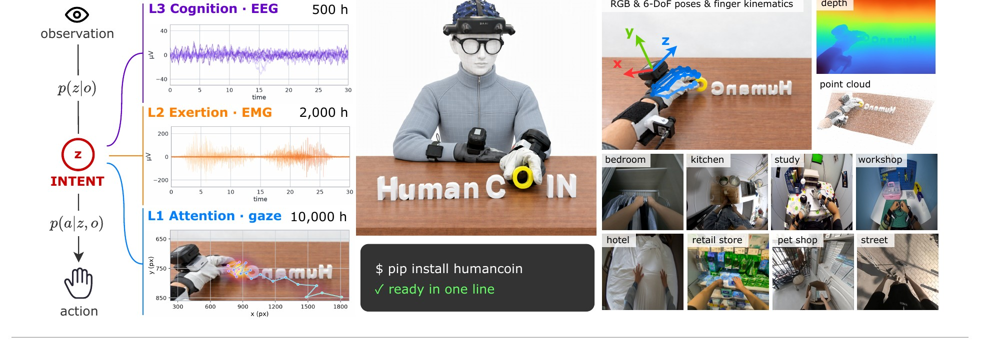
</p>

**一个 12,500 小时的第一视角操作数据集：在统一任务本体与统一时间轴上，按三种测量深度记录动作背后的意图信号——注视、表面肌电与脑电。**

<p align="center">
  <a href="https://flagopen.github.io/HumanCOIN/">项目主页</a> ·
  <a href="https://arxiv.org/abs/2611.26434">论文（arXiv:2611.26434）</a> ·
  <a href="https://flagopen.github.io/HumanCOIN-DataManager/">数据门户</a>
</p>

> 📖 English docs: [README.md](README.md)

---

## 目录

- [这是什么](#这是什么)
- [快速开始](#快速开始)
- [下载数据](#下载数据)
- [数据里有什么](#数据里有什么)
- [磁盘上的组织](#磁盘上的组织)
- [读取与对齐](#读取与对齐)
- [可视化](#可视化)
- [使用数据：默认帧与意图代理输入](#使用数据默认帧与意图代理输入)
- [数据是怎么采集的](#数据是怎么采集的)
- [与其他数据集对比](#与其他数据集对比)
- [录制自己的多频流](#录制自己的多频流)
- [引用与许可](#引用与许可)
- [致谢](#致谢)
- [合作机构](#合作机构)

---

## 这是什么

多数第一视角数据集记录的是「观测–动作」对：相机看到了什么，手怎么动。用这种数据训练的策略学习 `π(a | o)`，把操作者的意图压进网络权重；世界模型则预测下一帧观测，而不是产生动作的那个状态。策略失败时，数据无法告诉你究竟是目标错了、握力估错了，还是漏掉了一个错误信号。

HumanCOIN 记录的是中间那一段。每条 episode 都带有三种**可穿戴的意图代理信号**，它们沿着从决策到动作的「意图通路」分布：

- **注视（gaze）**——手出发之前，注意力先落在哪里；
- **表面肌电（sEMG）**——接触之前，前臂如何为握力加载；
- **头皮脑电（EEG）**——运动命令下达之前，皮层准备了什么。

这些代理信号不是意图本身，而是对意图的有损测量。数据集的设计目标是让模型能够从 `m = (m_gaze, m_emg, m_eeg)` 学习 `p(a | o, m)`，并与 `p(a | o)` 对比。报告结果时需要保留这个区别：HumanCOIN 提供的是意图的**测量与估计**，不是意图的隐变量标签。

### 形式化视角

令 `o` 为观测、`a` 为动作、`z` 为操作者的潜在意图。标准策略把 `z` 边缘化掉：

$$
p(a \mid o) = \int p(a \mid o, z)\, p(z \mid o)\, \mathrm{d}z .
$$

HumanCOIN 不试图直接观测 `z`，而是记录意图通路上的代理向量：

$$
m_j = f_j(z_j, o) + \varepsilon_j, \qquad j \in \{\mathrm{gaze},\ \mathrm{emg},\ \mathrm{eeg}\},
$$

其中 `f_j` 是传感器相关的有损读出函数，`ε_j` 是噪声；`m` 不是 `z` 的充分统计量。因此，这份数据支持的监督信号是**以代理信号为条件的策略**

$$
p(a \mid o, m),
$$

以及代理模型 `p(m | o)`。

这份语料对应两个相互独立的监督问题：

$$
\max_\phi\ \mathbb{E}_{(o,m)}\left[\log p_\phi(m \mid o)\right],
\qquad
\max_\theta\ \mathbb{E}_{(o,m,a)}\left[\log p_\theta(a \mid o, m)\right].
$$

前者在记录了 `m` 的地方学习代理模型；后者在有动作或动作标签的地方学习策略。把二者分开，正是层级设计的意义：浅层可以在没有机器人的情况下提供 `p(m | o)` 监督，L3 则提供策略所需的 `(o, m, a)` 配对。

真正要回答的问题是：代理信号是否携带了观测之外的动作信息。对应的量是条件互信息

$$
I(a; m \mid o) = \mathbb{E}[\log p(a \mid o, m) - \log p(a \mid o)],
$$

它在理论上非负，实践中必须用留出数据估计：显著大于零说明 `m` 增加了信息，和零无法区分则说明在该任务上意图相对观测是冗余的。受控 L3 提供的实测注视、位姿与手指运动学 `y` 是估计值的参考目标，而不是 `z` 的真值。

<p align="center">
  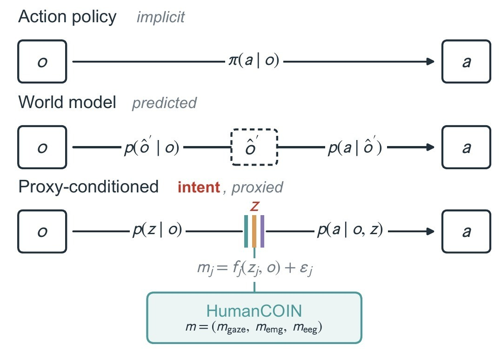
  <br>
  <sub>动作策略把意图折进权重；世界模型预测未来；HumanCOIN 直接记录意图的代理信号。图源：论文。</sub>
</p>

### 三个层级

这不是三个互不相干的数据集，而是一组嵌套的层级：每一层继承下一层的全部代理信号，再增加一种。信号越深，采集成本越高，小时数越少。

| 层级 | 小时数 | 新增的意图代理 | 典型数据流 | 采集环境 | 场景类别 |
|------|--------|----------------|------------|----------|----------|
| **L1 · 注意**<br>Attention | 10,000 | 从头环视频估计注视（30 Hz） | 2–6 路头戴相机（20–60 fps）、深度、6-DoF/身体/手部位姿 | 开放环境，日常活动，不设脚本 | 38 类 |
| **L2 · 用力**<br>Exertion | 2,000 | 双侧表面肌电，每臂 8 通道，2 kHz | 固定 4 目头环、2 路腕部视角、肌电原始与去噪轨迹 | 开放环境，任务单驱动的半结构化任务 | 21 类 |
| **L3 · 认知**<br>Cognition | 500 | 脑电：受控环境 128 通道 @1 kHz；开放环境 32/8 通道 @250 Hz | 4 路头部 + 2 路腕部 + 眼动相机 + 第三人称、眼动仪、3 个 6-DoF tracker、手部骨架 | 约 350 h 受控桌面 + 约 150 h 开放 | 9 类 |

L1 不含肌电和脑电；L2 增加肌电；L3 增加脑电，并在受控子集中直接测量注视、头/腕位姿和手指运动学。受控 L3 的实测值是浅层估计值的**参考**，而不是意图本身的真值。

### 一览

| 维度 | 数值 |
|------|------|
| 规模 | 12,500 小时 · 30 fps 下约 13.5 亿个主帧 · 6 个采集点 |
| 场景 | 5 个功能区（居住、商业、专业、工业、公共）共 38 类，另有 1 个残差类 |
| 任务 | 99 个任务动词 + 46 个动作动词；每个 episode 约 10 个步骤阶段 |
| 物体 | 635 个标注类别；839 个实测实例，记录形状、尺寸、重量、材质与颜色 |
| 信号 | 多视角 RGB、度量深度与点云、6-DoF 头/腕位姿、手指运动学、注视、sEMG、EEG、IMU、麦克风 |
| Episode | 平均 88 秒（L1 101 秒、L2 65 秒、L3 60 秒），长度分布峰值在 52 秒 |
| 格式 | LeRobot 风格：每个数据流一个 Parquet，外加主索引、MP4 视频，以及存在时的 WAV 音频；具体 `codebase_version` 由各发布的 `meta/info.json` 声明 |
| 许可 | 数据 CC BY-NC 4.0；代码 Apache-2.0 |

<p align="center">
  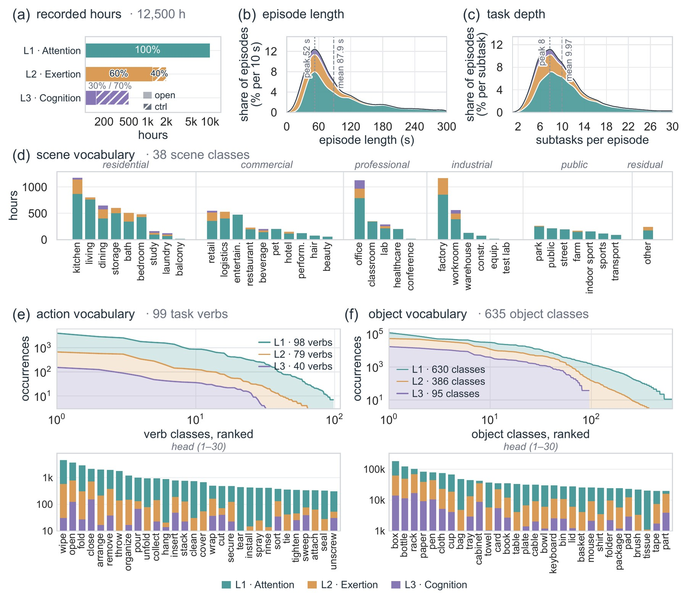
  <br>
  <sub>一图看全：三层小时数、episode 长度、任务深度、38 类场景、99 个任务动词与 635 类物体。图源：论文。</sub>
</p>

<p align="center">
  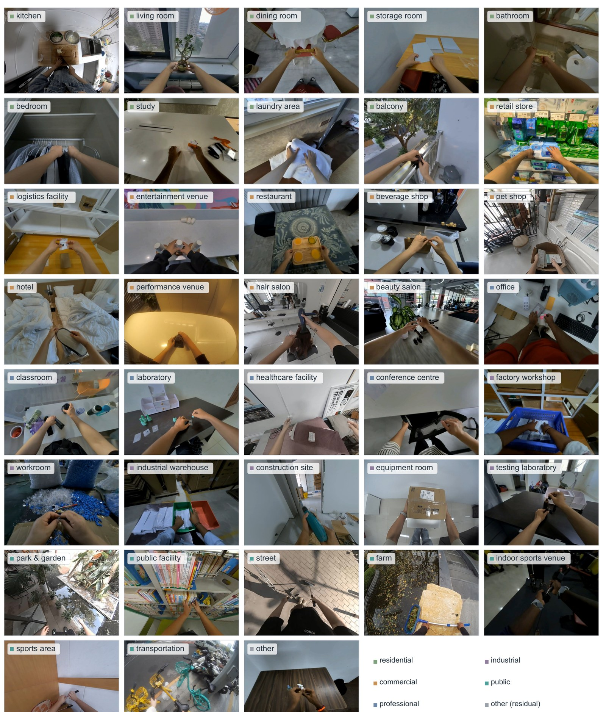
  <br>
  <sub>每个场景类取一帧头戴相机画面，按功能区排列。图源：论文。</sub>
</p>

**目录与语料不是一回事。** 12,500 小时是论文描述的完整语料规模，数据分批发布，因此门户中的实时目录会小于这个数字并持续增长——2026 年 11 月的快照约为 689 个仓库、12,119 个 episode、530 小时（约 7.5 TB）。今天能下载什么，请以[数据门户](https://flagopen.github.io/HumanCOIN-DataManager/)的统计和数据集卡片为准。后续批次的数据访问，门户给出的联系方式是 `humancoin@163.com`。

---

## 快速开始

从零到解出一帧真实数据，大约五分钟。下面的例子是一个 65 MB、29 秒的 L1 仓库；换成门户里的任何其他仓库，流程相同。

### 1. 安装

```bash
pip install -U "humancoin>=0.1.1"
```

支持 Python 3.10–3.13。包会固定 LeRobot 0.3.3，并自带下载器、数据读取器和两个可视化器。

### 2. 选一个数据集并下载

打开 **[HumanCOIN 数据门户](https://flagopen.github.io/HumanCOIN-DataManager/)**，按层级、模态、场景、任务或分辨率筛选，勾选一个或多个仓库，选择 Hugging Face 或 ModelScope，然后点 **Generate Download Command**。门户会自动填好仓库名和所选数据源对应的修订版本：

```bash
humancoin-download --hub huggingface \
  --datasets 'HumanCOIN/l1_study_room_fill_task_1920x1456_30fps_2views' \
  --revision 'b1b5d76c9a06d100733f4e4eac1a3e5f8942dfba' \
  --target-dir ./data --max-workers 8
```

文件会落在 `./data/HumanCOIN/<仓库名>/`。L1 仓库会把一条或多条任务录制放在各自的 `<task-name>/` 目录下，每个任务目录才是一个完整数据集；L2/L3 仓库是扁平的，可以直接从仓库根目录加载。多数数据集需要申请访问：先在 Hugging Face 数据集页面申请并等待通过，然后在同一个终端里登录，再执行下载：

```bash
hf auth login
hf auth whoami
```

使用 ModelScope 时，先在魔搭申请访问权限，用同一账号创建访问令牌并导出 `MODELSCOPE_TOKEN`；完整流程见 [ModelScope：申请、令牌与下载](#modelscope申请令牌与下载)。

> **想直接看最深的一层？** `l3_bedroom_fold_clothes_eye_1600x1200_30fps_12views_eeg128_emg8` 是一条 28 秒、188 MB 的 L3 episode，包含 128 通道脑电和 8 通道肌电，是查看完整传感器组合成本最低的入口。

### 3. 读一帧

```python
from pathlib import Path
from humancoin import HumanCOINDataset

REPO = "HumanCOIN/l1_study_room_fill_task_1920x1456_30fps_2views"
repo_dir = Path("data") / REPO
task_dir = repo_dir if (repo_dir / "meta/info.json").is_file() else next(
    p for p in sorted(repo_dir.iterdir()) if (p / "meta/info.json").is_file()
)

ds = HumanCOINDataset(repo_id=REPO, root=task_dir)

print(task_dir.name)                        # l1_study_room_fill_box_<hash>
print(len(ds), "frames @", ds.fps, "fps")   # 882 frames @ 30.0 fps
frame = ds[0]

print(frame["observation.images.head_left_rectified"].shape)  # (3, 1456, 1920)
print(frame["observation.head_pose"].shape)                   # (7,)
print(frame["eye_gaze_predict"].shape)                        # (2,)
print(frame["task"])                                          # 任务字符串
```

`frame` 里的每个键都来自某个任务目录中的某条 episode。`ds[i]` 先查第 i 个主时钟时间戳，再围绕该时刻解析每一路数据流；没有任何数据流在写入时被预重采样。对于扁平的 L2/L3 仓库，直接把仓库根目录作为 `root` 传入。

### 4. 看一看

```bash
# 指向上一步打印的任务目录（扁平的 L2/L3 仓库直接用仓库根目录）
TASK=$(dirname "$(dirname "$(find "data/HumanCOIN/l1_study_room_fill_task_1920x1456_30fps_2views" -path '*/meta/info.json' | head -n 1)")")
humancoin-visualize-web "$TASK"
```

浏览器界面默认打开 `http://127.0.0.1:8000`，可以逐帧拖动、拉时间窗、查看每一路信号，并对脑电/肌电做滤波。桌面可视化器和快捷键见[可视化](#可视化)。

---

## 下载数据

有两种方式获取数据：用门户生成 `humancoin-download` 命令，或手写同样的命令。推荐前者，因为门户会替你解析仓库名、修订版本、大小和访问权限。

### 数据门户

**[HumanCOIN 数据门户](https://flagopen.github.io/HumanCOIN-DataManager/)** 是已发布数据的公开目录。

<p align="center">
  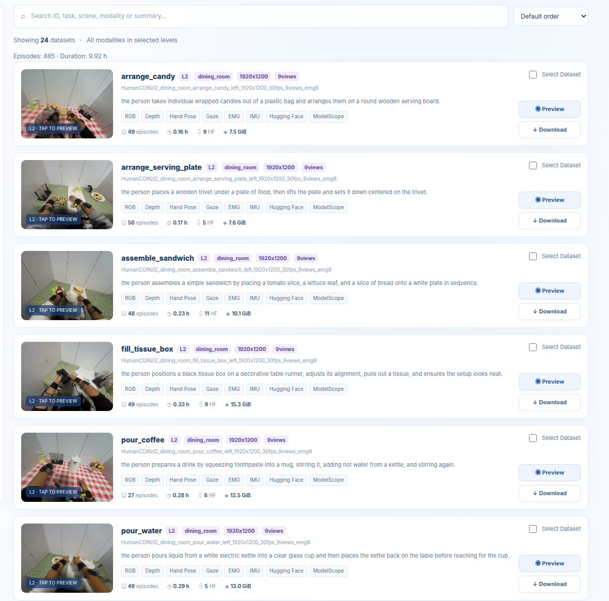
  <br>
  <sub>Explore Datasets：搜索、比较已发布仓库；每张卡片给出传感器集合、大小，以及 Preview / Download 操作。</sub>
</p>

<p align="center">
  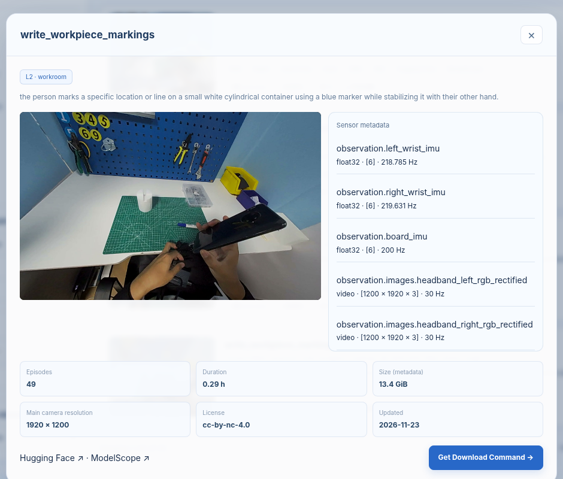
  <br>
  <sub>数据集卡片：任务描述、逐流元数据、episode 数、时长、大小、许可，以及 <b>Get Download Command</b> 入口。</sub>
</p>

1. **浏览。** 首页显示已发布仓库数、episode 数、总时长和 Hugging Face 下载量。**Explore Datasets** 可以按数据层级（L1/L2/L3）、模态（RGB、深度、手部位姿、注视、眼动相机、肌电、脑电、手套/Manus、音频、IMU）、场景、任务和主相机分辨率筛选。
2. **预览。** 数据集卡片给出任务描述、episode 数、时长、大小、分辨率、许可和完整的流列表。完整视频预览从 Hugging Face 流式加载，受限仓库需要先获得访问权限。
3. **选择。** 勾选一个或多个完整仓库。选择会保存在浏览器里，也可以导出/导入 `selection.json`，便于分享可复现的数据子集。
4. **选择源。** Hugging Face 或 ModelScope。有的仓库只在一个平台发布；门户会提示当前平台是否可用。
5. **生成命令。** 生成的命令会选择卡片上标注的修订版本——Hugging Face 上是 commit，ModelScope 上通常是 `master`——使下载内容对应目录快照：

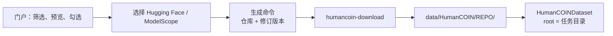

```bash
humancoin-download --hub huggingface \
  --datasets 'HumanCOIN/<repository>' \
  --revision '<commit-hash>' \
  --target-dir ./data --max-workers 8
```

在完成认证的同一个终端里执行。加 `--dry-run` 可以只打印目标路径和 include/exclude 规则，不实际下载。

### 仓库命名

仓库名本身包含足够的信息，方便不打开卡片也能筛选：

```text
l1_study_room_fill_task_1920x1456_30fps_2views
│  │          │    │        │      │     └─ 发布的相机视角数
│  │          │    │        │      └─ 帧率
│  │          │    │        └─ 主相机分辨率
│  │          │    └─ 任务
│  │          └─ 场景
│  └─ 层级
```

L2/L3 会在名字末尾追加传感器组合，例如 `..._9views_emg8` 或 `..._12views_eeg128_emg8`。场景、任务和视角数都能在门户里直接搜索，通常不需要手工解析名字。

### 命令行参数

```bash
humancoin-download --help
# 也可以：python -m humancoin.download --help
```

| 参数 | 含义 |
|------|------|
| `--hub {huggingface,modelscope}` | 数据源（默认 `huggingface`） |
| `--datasets A B ...` | 一个或多个仓库名或 `owner/name`；`--ds_lists` 是别名 |
| `--revision REV` | 分支、标签或 commit；门户会填入对应数据源的修订版本（Hugging Face 上是 commit，ModelScope 通常是 `master`） |
| `--target-dir DIR` | 下载根目录（默认 `~/.cache/huggingface/lerobot`）；文件写到 `DIR/HumanCOIN/<name>` |
| `--max-workers N` | 并行下载的文件数（默认 8） |
| `--include ...` / `--exclude ...` | 相对仓库根目录的 glob，用于部分下载 |
| `--dry-run` | 只打印计划，不下载 |
| `--token TOKEN` | 访问令牌；优先使用 `HF_TOKEN` / `MODELSCOPE_TOKEN`（也接受 `MS_TOKEN`） |
| `--namespace NAME` | 裸仓库名使用的命名空间（默认 `HumanCOIN`） |

示例：

```bash
# 一次下载多个仓库
humancoin-download --hub huggingface \
  --datasets 'HumanCOIN/l1_study_room_fill_task_1920x1456_30fps_2views' \
             'HumanCOIN/l3_bedroom_fold_clothes_eye_1600x1200_30fps_12views_eeg128_emg8' \
  --target-dir ./data --max-workers 8

# 下载前先看落盘位置
humancoin-download --datasets 'HumanCOIN/l1_study_room_fill_task_1920x1456_30fps_2views' \
  --target-dir ./data --dry-run

# 扁平的 L2/L3 仓库：只要元数据和标定（体积小，但不是可加载的完整数据集）
humancoin-download --datasets 'HumanCOIN/<repository>' --target-dir ./data \
  --include "meta/*" "calibrations/*"
```

重复执行是安全的：Hub SDK 会复用已下载的文件，中断的传输可以继续。某个仓库失败不会中断其余仓库；只要有失败，进程最终返回非零退出码。

### ModelScope：申请、令牌与下载

ModelScope 提供同一目录的镜像。下载受限仓库时：

<p align="center">
  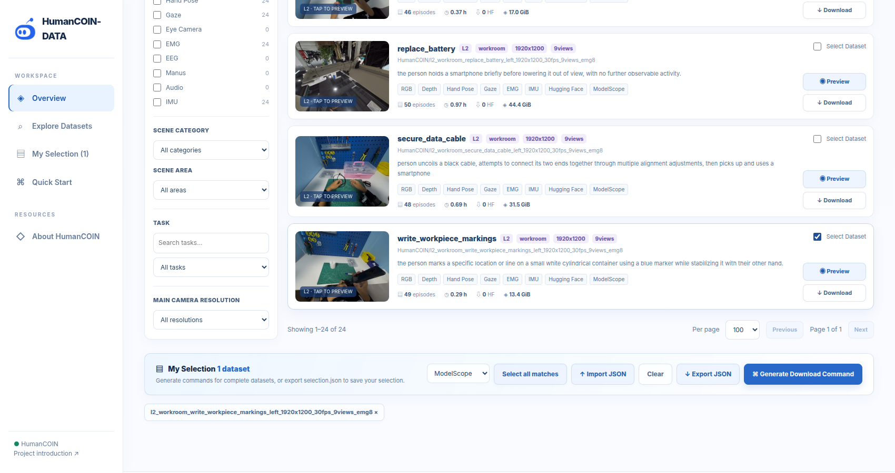
  <br>
  <sub>勾选一个或多个完整仓库，把数据源切到 <b>ModelScope</b>，再点 <b>Generate Download Command</b>。同一个选择栏可以导出 <code>selection.json</code> 供下次导入。</sub>
</p>

1. 用将要执行下载的账号，在 ModelScope 数据集页面申请访问权限。
2. 用同一账号创建一个 [ModelScope 访问令牌](https://modelscope.cn/my/myaccesstoken)。
3. 在用于下载的 Bash 终端里交互式导出令牌，避免它进入 shell 历史：

```bash
read -rsp 'ModelScope Token: ' MODELSCOPE_TOKEN
printf '\n'
export MODELSCOPE_TOKEN
```

4. 执行门户生成的命令。ModelScope 命令使用 `--hub modelscope`，修订版本通常是 `--revision 'master'`：

```bash
humancoin-download --hub modelscope \
  --datasets 'HumanCOIN/l2_workroom_write_workpiece_markings_left_1920x1200_30fps_9views_emg8' \
  --revision 'master' \
  --target-dir ./data --max-workers 8
```

文件会落在 `./data/HumanCOIN/<仓库名>/`，任务目录布局与 Hugging Face 路径一致。`--dry-run`、`--include`/`--exclude` 以及门户导出的 `selection.json` 在两个源上用法相同，区别只在 hub 和修订版本。下载器会读取 `MODELSCOPE_TOKEN` 或 `MS_TOKEN`；也可以用 `--token`，但交互式导出可以避免把密钥写进可能被保存的命令。`master` 是可变分支；需要字节级复现时，请固定到 commit 或 tag（若有）。

### 访问、磁盘与校验

- **受限数据。** 多数 HumanCOIN 仓库是 gated（自动审批）。先在 Hugging Face 数据集页面申请访问，等待通过，再 `hf auth login`。下载器返回 401/403，通常是审批未通过，或当前 token 属于另一个账号。
- **ModelScope。** 申请访问、导出 `MODELSCOPE_TOKEN` 与执行门户命令的完整流程见 [ModelScope：申请、令牌与下载](#modelscope申请令牌与下载)。
- **磁盘。** 体积差异很大：快速开始用的 L1 示例只有 65 MB，而 L2/L3 仓库通常为多 GB，最大的超过 60 GB；完整已发布目录约 7.5 TB。选层级之前先看卡片上的大小；`df -h` 比下载失败便宜。
- **校验。** 扁平的 L2/L3 仓库在根目录有 `meta/info.json`；L1 仓库则在每个 `<task>/meta/info.json` 下。无论哪种，完整任务目录还应至少有一个 `data/chunk-*/episode_*/master_index.parquet`。只有 `meta/` 没有 `data/`，说明下载不完整或仍在进行。

---

## 数据里有什么

一条 episode 是「一个人在真实场景里完成一项任务」的时间对齐记录：身体、场景和动作背后的信号，被放进同一个坐标系和同一条时钟。

<p align="center">
  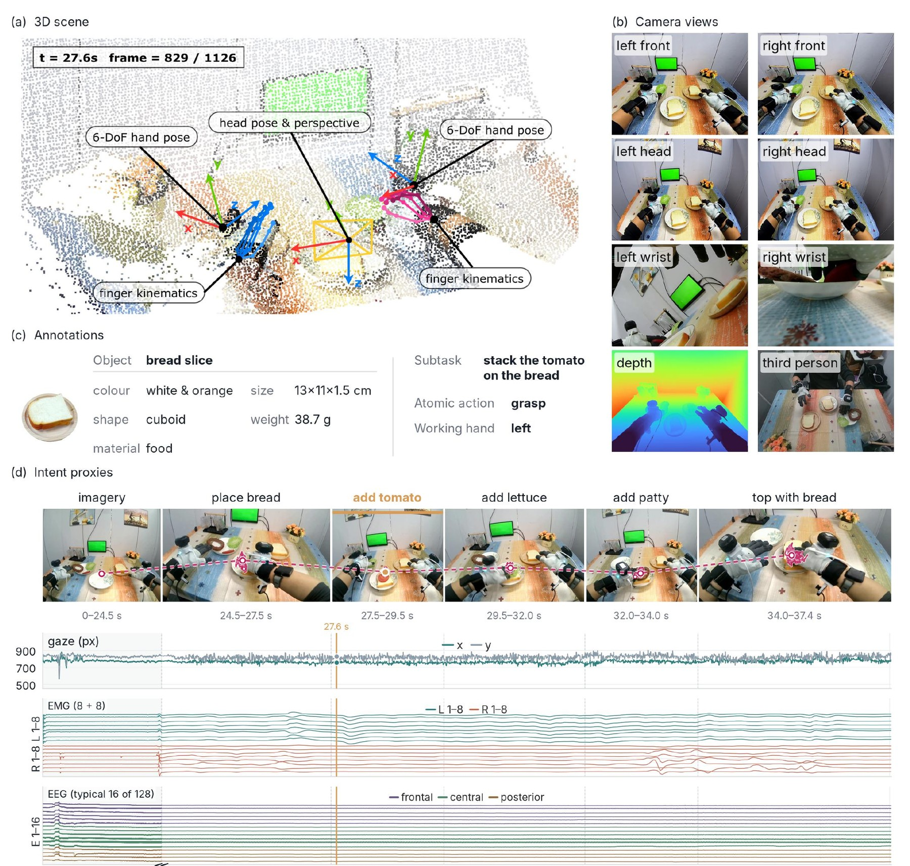
  <br>
  <sub>一条受控 L3 episode，t = 27.6 s。(a) 度量点云，叠加头部位姿、双手骨架与 6-DoF 腕部位姿；(b) 八路同步视角与深度；(c) 步骤与物体标注；(d) 同一时间区间内的注视、肌电与脑电。图源：论文。</sub>
</p>

### 视角与几何

- **头部相机。** L1 使用来自 13 家厂商的 14 款第三方头环：2–6 个镜头，20–60 fps，从 512×512（校正后）到 3840×1200。L2/L3 使用头戴多相机设备，通常是 1920×1200、30 fps 的四目；前向立体对硬件同步。发布流可能被降采样（例如部分 L3 仓库的头部视角是 640×360），因此一律以 `info.json` 里的 shape 为准。
- **腕部与第三人称。** L2 增加两路腕部视角；L3 增加两个 640×480 腕部相机、一路 1600×1200 的眼动仪场景相机，并在受控子集中加入第三人称 RGB-D 视角。按套件不同，L3 仓库会发布 5–12 路视角。
- **深度与点云。** 深度由前向立体对经 FoundationStereo 重建，连同产生它的内参一起存储，再逐帧投影为点云。发布中同时提供原始与校正版本时就都保留；校正参数随 episode 一起发布。
- **位姿与手。** 头部、双腕和胸部共享一个度量坐标系：`+x` 向左、`+y` 向上、`+z` 向前；平移单位为毫米，关节角单位为度。位姿流可能存成 7 个数（位置 + 四元数），也可能存成 6 个数（位置 + 欧拉角）；读取 `names` 即可确认。受控 L3 用 3 个 6-DoF tracker（设备频率约 800 Hz）和 20 节点手套直接测量位姿与每只手 20 个关节角；L1、L2 和开放 L3 的同一批量则从视频估计。

### 意图代理信号

| 代理 | 典型数据流 | 频率 | 实测还是估计 |
|------|------------|------|--------------|
| 注视 | `observation.eye_gaze`（受控 L3）；`eye_gaze_predict`（L1、L2、开放 L3） | 实测 200 Hz；估计 30 Hz | 受控 L3 实测，其余估计 |
| 表面肌电 | `observation.left_wrist_emg` 及其原始/去噪变体（`*_raw`、`*_denoise`，命名随发布变化） | 2 kHz，每臂 8 通道 | L2 起为实测 |
| 脑电 | `observation.eeg_raw`、`observation.eeg_denoise`（不同发布批次命名略有差异） | 受控 1 kHz × 132 列（128 通道帽）；开放 250 Hz × 32/8 通道 | L3 实测 |

注视坐标是场景相机像素（受控 L3），或校正后头部视角的像素（其余情况）。肌电发布原始与去噪轨迹；需要包络时由使用者自行计算。脑电按采集、滤波、修复等阶段分别发布；具体列名以每个仓库的 `meta/info.json` 为准。


### 标注

标注以「步骤」为单位，而不是只给整段视频打一个标签。每个步骤包含一句描述、一个**任务动词**（99 类：wipe、open、fold、close、arrange……）、使用的手、接触到的物体，以及一组**动作动词**（46 类，平均每步 2.5 个：pick、place、move、grasp……）。在 L2/L3，物体记录可以包含实测的形状、尺寸、重量、材质和颜色（是否完整随发布批次变化），因此肌电活动可以直接对照物体属性，而不是只依赖标签。

每条 episode 还带有任务阶段、关键事件、状态变化，以及受控 L3 中「运动想象 / 执行」的阶段标记。标注以结构化 JSON 随 episode 发布，同时导出为 LeRobot 的语言列供训练使用。

---

## 磁盘上的组织

一个**任务目录**才是一个自包含的 LeRobot 风格数据集。仓库可能是「根目录就是任务目录」（L2/L3），也可能在根目录下放多个任务目录（L1）。具体的数据流集合随层级和套件变化，目录结构不变。

```text
l1_study_room_fill_task_1920x1456_30fps_2views/     # 仓库
├── README.md
├── preview.jpg
├── portal.yaml
└── l1_study_room_fill_box_<hash>/                  # 任务目录 = 数据集根目录
    ├── data/
    │   └── chunk-000/
    │       └── episode_000000/
    │           ├── master_index.parquet            # timestamp | frame_index | episode_index | index | task_index
    │           ├── observation.head_pose.parquet
    │           ├── observation.hand_left_points.parquet
    │           ├── observation.body_pose.parquet
    │           └── ...                             # 每路信号一个 Parquet
    ├── videos/
    │   └── chunk-000/
    │       ├── observation.images.head_left_rectified/
    │       │   └── episode_000000.mp4
    │       └── ...
    ├── audios/                                     # 采集了麦克风时存在
    │   └── chunk-000/...
    ├── calibrations/
    │   ├── dataset_manifest.json
    │   ├── rectify_params.yaml
    │   └── source_camera_calibration.json
    ├── annotation/
    │   └── episode_000000_structured.json
    └── meta/
        ├── info.json                               # 特征、形状、fps、窗口、路径模板
        ├── episodes.jsonl
        ├── episodes_stats.jsonl
        ├── tasks.jsonl
        ├── readme.json                             # 该任务的人类可读摘要
        ├── collect_info.jsonl                      # 存在时：采集者、硬件、场景、物体
        ├── alignment_check.jsonl                   # 存在时：逐流时间对齐审计
        └── qc_reports.jsonl                        # 存在时：质检结论
```

L2 和 L3 仓库没有这一层：`data/`、`videos/`、`meta/` 直接位于仓库根目录。判断依据就是 `meta/info.json`——如果仓库根目录没有它，就进入包含它的那个子目录。元数据集合随发布批次略有差异：`info.json`、`episodes.jsonl`、`episodes_stats.jsonl`、`tasks.jsonl` 和 `readme.json` 是常见项；L2/L3 还可能包含 `collect_info.jsonl`、`alignment_check.jsonl`、`calibrations.jsonl`、`source_sessions.jsonl` 和 `qc_reports.jsonl`。

每路信号是一个独立的 Parquet，按自己的时间基存储：

```text
timestamp (float64) | episode_index (int64) | channel_0 ... channel_D
```

- `timestamp` 是相对录制起点的秒数，按采集到的值存储。没有任何样本被吸附到主帧网格上，因此原生频率、设备抖动和丢帧都保留在文件里。
- `master_index.parquet` 是固定频率的主干（已发布数据为 30 fps）。`ds[i]` 先查这里，再用每一路自己的时间戳解析其余数据。
- 像素不存进 Parquet。RGB 视角是 30 fps 的 H.264 MP4；同名的 `observation.images.*.parquet` 记录每一帧的时间戳。原始版和校正版并列存放。
- 有音频时，是 16 kHz 单声道 PCM WAV，外加一张记录每个主帧贡献多少采样的 Parquet。
- 标定信息（相机内参与畸变、校正参数、tracker 到坐标系的变换、眼动仪标定）随 episode 一起发布，几何可以重新推导，而不是只能接受写入时的结果。
- 命名是字面含义：`*_raw` 是采集到的原始流，`eeg_denoise` / `*_emg_denoise`（或 `.denoised`）是清洗后的轨迹，肌电包络可由清洗后的轨迹计算。

不同发布批次可能多几个元数据文件，或少几路数据流。权威的特征列表永远是：

```python
for key, spec in ds.meta.features.items():
    if key in {"timestamp", "frame_index", "episode_index", "index", "task_index"}:
        continue
    print(f"{key:48s} {spec.get('dtype', ''):8s} {tuple(spec.get('shape', ()))}")
```

---

## 读取与对齐

### 主时钟与窗口

数据集自身的帧率定义了一条**主时钟**。第 `i` 帧的时间戳是 `t = i / fps`（相对该 episode 的主时间基）。其他数据流保留各自的原生时间戳；读取 `ds[i]` 时，每一路围绕 `t` 按自己的 `window` 解析：

| `window` | 返回值 | 典型用途 |
|----------|--------|----------|
| `None`（默认） | 最近的一个采样 | 30 Hz 状态、RGB 帧、一个音频 chunk |
| `"interpolate"` | 在 `t` 处线性插值 | 中频位姿或轨迹 |
| `(start, end)` | `(t + start, t + end]` 内的全部采样，以及 `"<key>_timestamps"` | 注视、肌电、脑电、高频 IMU |

窗口是读取时的选择，存放在 `meta/info.json`，因此同一个仓库可以在不改写数据的前提下按不同时间分辨率消费。也可以在构造数据集时逐特征覆盖：

```python
ds = HumanCOINDataset(
    repo_id="HumanCOIN/l3_bedroom_fold_clothes_eye_1600x1200_30fps_12views_eeg128_emg8",
    root="data/HumanCOIN/l3_bedroom_fold_clothes_eye_1600x1200_30fps_12views_eeg128_emg8",
    window_overrides={
        "observation.eye_gaze": (-1 / 30, 0.0),
        "observation.eeg_denoise": (-1 / 30, 0.0),
        "observation.left_wrist_emg": (-1 / 30, 0.0),
    },
)

item = ds[100]
print(item["timestamp"])                          # tensor(3.3333)
print(item["observation.eye_gaze"].shape)         # 约 [6, 2]
print(item["observation.eeg_denoise"].shape)      # 约 [33, 132]
print(item["observation.left_wrist_emg"].shape)   # 约 [66, 8]
print(item["observation.images.head_rgb"].shape)  # [3, 360, 640]
print(item["action"].shape)                       # [58]
```

> **循环前先确认键名。** 不同发布批次的特征名可能略有差异（例如卡片里的 `observation.left_wrist_emg` 与 Parquet 文件里的 `*_emg_raw` / `*_emg_denoise`）。以你下载的这份数据中 `ds.meta.features` 打印出的键为准。

<p align="center">
  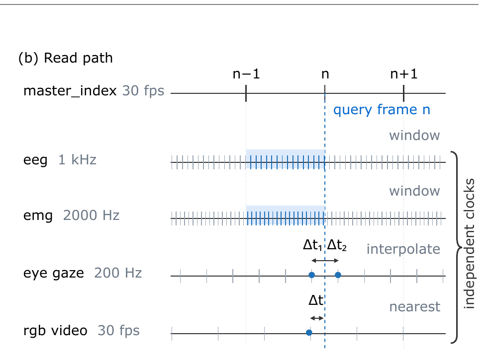
  <br>
  <sub>读取路径（论文 Fig. 6b）。固定频率的主索引给出第 <code>n</code> 帧；每一路按自己的时钟解析——脑电/肌电用窗口，注视用插值，RGB 用最近邻——写入时不重采样。图源：论文。</sub>
</p>

第一次访问某条 episode 时，每路 Parquet 会被加载并缓存；之后再读同一 episode 的其他帧就很快。视频帧按需解码。因此顺序读取远快于跨 episode 随机读取，`num_workers > 0` 会成倍增加内存，因为每个 worker 都有自己的缓存。

### 索引列与任务标签

`item` 还包含 `timestamp`、`frame_index`、`episode_index`、`index`、`task_index` 和 `task`。`index` 是仓库内的全局帧号；`task` 是当前帧对应的任务字符串。在 L3，`observation.state` 与 `action` 是 58 维融合向量：双腕位姿与头部位姿（18 维）加 40 个手指关节角。

### 子集、偏移与 delta 时间戳

```python
# 只加载指定 episode
ds = HumanCOINDataset(repo_id=..., root=..., episodes=[0, 2])

# 把一个特征在查询帧前后若干偏移上堆叠起来
ds = HumanCOINDataset(
    repo_id=..., root=...,
    delta_timestamps={"observation.head_pose": [-0.5, 0.0, 0.5]},
)
item = ds[100]
print(item["observation.head_pose"].shape)   # [3, 7]
```

`delta_timestamps` 适合取短时上下文。当前实现会把同一组偏移应用到被堆叠的特征上，因此依赖逐特征对齐时请只传一组偏移。

### 深度、音频与缺失值

- **深度。** 当元数据标记了 `video.is_depth_map` 且形状为 `(H, W, 1)` 时，视角按原生采样格式解码为 `(1, H, W)`（例如 `gray12le` 对应 `uint16`），不做 RGB 转换，也不除以 255。部分发布把深度存成 `(H, W)`；读取前先确认 `info.json` 里的 `shape` 和 `video.is_depth_map`，不要默认当 RGB 处理。单位和无效值保持存储时的定义。
- **音频。** 最近邻读取返回一个完整 chunk；`(start, end)` 窗口返回跨 chunk 边界的精确采样切片并拼接。chunk 以第一个采样为标签，采样间隔严格为 `1 / sample_rate`。
- **缺失。** 手部跟踪丢失、注视无效、脑电坏导联会表现为 `NaN` 或空窗口，而不是伪造的值。高频窗口的长度可能相差一两个采样，因为时间戳没有吸附到网格。

### 组 batch

窗口特征是变长的，PyTorch 默认的 collate 会失败。可以在模型里补齐/裁剪，或使用列表 collate：

```python
from torch.utils.data import DataLoader

def collate(batch):
    return {key: [b[key] for b in batch] for key in batch[0]}

loader = DataLoader(ds, batch_size=4, shuffle=True, collate_fn=collate, num_workers=0)
```

---

## 可视化

### 门户预览

[数据门户](https://flagopen.github.io/HumanCOIN-DataManager/) 是下载前最快的查看方式：点开卡片可以看到任务描述、封面帧、传感器列表、episode 数、时长、大小和分辨率。完整视频预览从 Hugging Face 流式加载，受限仓库需要先获得权限。

### 浏览器可视化器（真实数据推荐）

```bash
# DATASET_ROOT 是任务目录；扁平的 L2/L3 仓库直接用仓库根目录
humancoin-visualize-web "<dataset-root>"
# 需要时指定端口或监听地址
humancoin-visualize-web "<dataset-root>" --port 8080 --no-browser
```

页面包含同步的相机面板、逐路信号条、可拖动的时间窗；数据里有对应流时还会显示 3D 位姿/手部骨架；发布中包含阻抗快照时，还会显示按质量分带的脑电电极网格。脑电/肌电条上可以做零相位 Butterworth 高通/低通，并在工频及其谐波上做梳状陷波；同样的滤波可以通过 API 传入，例如 `filt=observation.eeg_denoise:hp=0.5,lp=40,notch=50`。滤波是查看和分析的便利工具，不替代有记录的处理流程。

<p align="center">
  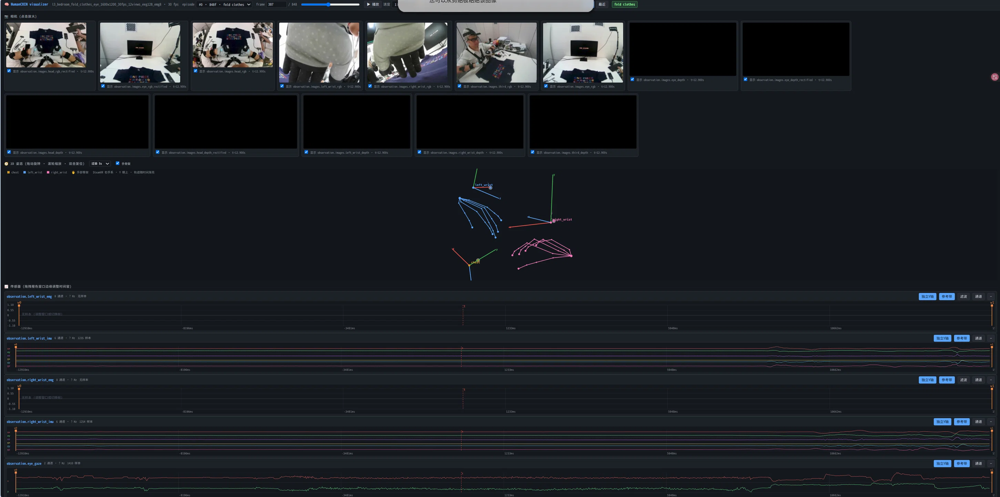
  <br>
  <sub>浏览器可视化器运行在真实 L3 episode（<code>l3_bedroom_fold_clothes_eye_1600x1200_30fps_12views_eeg128_emg8</code>，第 381/848 帧）：完整 raw/rectified 相机墙、3D 头/腕/手骨架，以及肌电、IMU 与注视信号条共用一条主时间轴。</sub>
</p>

### 桌面可视化器

```bash
humancoin-visualize "<dataset-root>" --episode 0
```


| 按键 | 作用 |
|------|------|
| `space` | 播放 / 暂停 |
| `←` `→` | 上一帧 / 下一帧 |
| `↑` `↓` | 加快 / 减慢播放 |
| `w` `s` | 放宽 / 收窄时间窗 |
| `q` / `Esc` | 退出 |

---

## 使用数据：默认帧与意图代理输入

`ds[i]` 已经返回了逐帧 batch 所需的内容：默认的 observation、state 和 action，以及 `info.json` 中配置好的代理信号窗口。不需要先自己拼一个窗口数据集。

| 键 | 典型形状 | 含义 |
|----|----------|------|
| `observation.images.head_rgb` | `(3, H, W)` | 相机帧 |
| `observation.state` | `(58,)` | 头/腕位姿 + 40 个手指关节的融合状态 |
| `action` | `(58,)` | 融合动作目标 |
| `observation.eye_gaze` | `(N_g, 2)` | 像素坐标注视窗口 |
| `observation.left_wrist_emg` | `(N_e, 8)` | 8 通道肌电窗口 |
| `observation.eeg_denoise` | `(N_c, 132)` | 132 通道脑电窗口 |

代理窗口是变长的，batch 时只需要 padding 和 mask，不需要重采样，也不需要手工拼时间维。先打印 `ds.meta.features`：有些发布把肌电放在 `*_raw` / `*_denoise` 等不同后缀下。

### 组默认字段的 batch

```python
from pathlib import Path

import torch
import torch.nn as nn
import torch.nn.functional as F
from torch.utils.data import DataLoader, Subset

from humancoin import HumanCOINDataset

REPO = "HumanCOIN/l3_bedroom_fold_clothes_eye_1600x1200_30fps_12views_eeg128_emg8"
ds = HumanCOINDataset(
    repo_id=REPO,
    root=Path("data") / REPO,
    tolerance_s=1 / 30,          # L3 视频可能比主时钟偏一帧
)

PROXY_KEYS = (
    "observation.eye_gaze",
    "observation.left_wrist_emg",
    "observation.eeg_denoise",
)


def collate(batch):
    out = {
        "observation.images.head_rgb": torch.stack(
            [b["observation.images.head_rgb"] for b in batch]),
        "observation.state": torch.stack([b["observation.state"] for b in batch]),
        "action": torch.stack([b["action"] for b in batch]),
    }
    for key in PROXY_KEYS:
        seqs = [b[key] for b in batch]
        length = max(len(seq) for seq in seqs)
        dim = seqs[0].shape[-1]
        padded = torch.zeros(len(seqs), length, dim)
        mask = torch.zeros(len(seqs), length, dtype=torch.bool)
        for i, seq in enumerate(seqs):
            if len(seq):
                padded[i, :len(seq)] = seq
                mask[i, :len(seq)] = True
        out[key] = padded
        out[f"{key}_mask"] = mask
    return out


loader = DataLoader(
    Subset(ds, range(1, len(ds))),   # 跳过第 0 帧，它的视频可能晚一个 tick
    batch_size=8,
    shuffle=True,
    collate_fn=collate,
)
```

### Demo：把 gaze / EMG / EEG 接入动作头

这个模型刻意做小：一个图像编码器、一个线性 state 编码器、每路代理一个编码器、对每个窗口做 masked mean pooling，最后接动作头。它足以演示注视、肌电和脑电如何与 `o`、`a` 进入同一次前向。

```python
class ProxyPolicy(nn.Module):
    def __init__(self, state_dim=58, action_dim=58, width=64):
        super().__init__()
        self.image = nn.Sequential(
            nn.Conv2d(3, 16, 5, stride=2, padding=2), nn.ReLU(),
            nn.Conv2d(16, 32, 3, stride=2, padding=1), nn.ReLU(),
            nn.AdaptiveAvgPool2d(1), nn.Flatten(),
            nn.Linear(32, width),
        )
        self.state = nn.Linear(state_dim, width)
        self.gaze = nn.Linear(2, width)
        self.emg = nn.Linear(8, width)
        self.eeg = nn.Linear(132, width)
        self.head = nn.Sequential(
            nn.Linear(width * 5, width * 2), nn.GELU(),
            nn.Linear(width * 2, action_dim),
        )

    @staticmethod
    def masked_mean(x, mask):
        x = x * mask.unsqueeze(-1)
        return x.sum(1) / mask.sum(1, keepdim=True).clamp_min(1)

    def forward(self, batch):
        image = F.interpolate(
            batch["observation.images.head_rgb"],
            size=(128, 128), mode="bilinear", align_corners=False,
        )
        z_img = self.image(image)
        z_state = self.state(batch["observation.state"])
        z_gaze = self.masked_mean(
            self.gaze(batch["observation.eye_gaze"]),
            batch["observation.eye_gaze_mask"],
        )
        z_emg = self.masked_mean(
            self.emg(batch["observation.left_wrist_emg"]),
            batch["observation.left_wrist_emg_mask"],
        )
        z_eeg = self.masked_mean(
            self.eeg(batch["observation.eeg_denoise"]),
            batch["observation.eeg_denoise_mask"],
        )
        return self.head(torch.cat([z_img, z_state, z_gaze, z_emg, z_eeg], dim=-1))


device = "cuda" if torch.cuda.is_available() else "cpu"
model = ProxyPolicy().to(device)
optimizer = torch.optim.AdamW(model.parameters(), lr=1e-4)

for step, batch in enumerate(loader):
    batch = {key: value.to(device) for key, value in batch.items()}
    pred = model(batch)
    loss = F.mse_loss(pred, batch["action"])
    optimizer.zero_grad()
    loss.backward()
    optimizer.step()
    print(f"step {step}: loss={loss.item():.4f}")
    if step == 0:               # 跑一步就能检查接线是否正确
        break
```

在真实 L3 episode 上，这段代码可以跑出一步有限 loss；这只说明形状和梯度接通了。

### 接到 LeRobot Diffusion Policy

LeRobot 的 `DiffusionPolicy` 消费 `observation.images.*`、`observation.state` 和 `action`，并用图像与 state 编码器构造 global conditioning。原版 `DiffusionConfig` 没有 gaze/emg/eeg 的一等输入。要把代理信号接进去，最小的改动是把三路代理 embedding 融合成一个向量，然后二选一：

- 拼到 `observation.state` 上，同时加宽策略的 state 特征维度；
- 在 `DiffusionModel._prepare_global_conditioning` 中作为额外的 global-conditioning token 注入。

`lerobot-train` 还要求一个合并成单表、带数据集统计量的 `LeRobotDataset`；HumanCOIN 的逐流布局不是那个格式。因此生产流水线需要一个小适配器，或先把固定频率视图物化。上面的 demo 刻意不假装 `DiffusionPolicy` 可以原样跑通。

### 为什么不能直接使用

- **动作空间是人体，不是机器人。** `action` 是 58 维融合位姿与手指向量；机器人需要重定向、隐动作空间或不同的输出头。
- **一条 episode 不构成数据集。** 这里是 28 秒录制上的接线测试，不是训练好的策略。
- **没有归一化和评测。** 动作与代理信号按原始尺度使用；真实训练需要统计量、训练/验证切分和任务指标。
- **代理键名会变。** 发布可能使用 `*_raw` / `*_denoise` 或 `left_wrist_emg` / `.denoised`；务必先读 `ds.meta.features`，替换成实际键名。
- **窗口默认很短。** 33 ms 的注视/肌电/脑电窗口只是默认查询，不一定适合作为意图的时间上下文；窗口长度是建模选择。

### 这份语料适合做什么

更有价值的用法在上一层：在 12,500 小时上预训练多模态表征、学习代理模型 `p(m | o)`、训练以意图为条件的架构 `p(a | o, m)`、在只有视频时估计注视/手部位姿，以及检验意图能否跨层迁移。**生产级训练配方不是本项目的重点**；重点是语料与读取工具。如果你在其上做出更强的基线、转换脚本或新架构，欢迎向社区贡献代码和 issue。

---

## 数据是怎么采集的

<p align="center">
  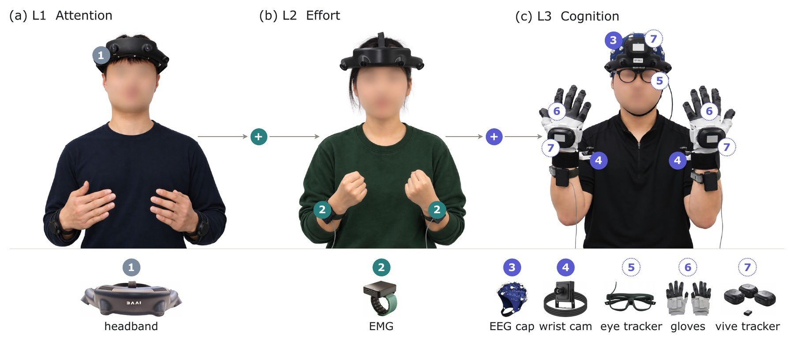
  <br>
  <sub>三套设备。L1：第三方头环。L2：固定四目头环 + 双侧肌电臂环。L3：在 L2 基础上加脑电、腕部相机，受控环境下再加眼动仪、手套与 6-DoF tracker。图源：论文。</sub>
</p>

### 硬件配置

| 层级 | 数据流 | 设备（示例） | 原生分辨率 / 通道 | 频率 | 单位 |
|------|--------|--------------|-------------------|------|------|
| L1 | 头部 RGB | 第三方头环：14 款、13 家厂商、2–6 目 | 512×512–3840×1200 | 20–60 fps | RGB |
| L2 | 头部 RGB | 四目头环，前向立体对硬件同步 | 1920×1200 | 30 fps | RGB |
| L2/L3 | 腕部 RGB | JIERUIWEITONG FH868 | 640×480（部分 L2 发布为 1920×1080） | 30 fps | RGB |
| L3 | 眼动场景相机 | Pupil Labs Neon | 1600×1200 | 30 fps | RGB |
| L3 | 第三人称 | Intel RealSense D455f | 640×480 | 30 fps | RGB-D |
| L3 | 注视 | Pupil Labs Neon | 场景相机中的 x, y 像素 | 200 Hz | px |
| L3 | 头/腕位姿 | HTC VIVE Tracker 3.0 ×3 | 同一坐标系下的 6-DoF | 设备约 800 Hz | mm / deg |
| L3 | 手指运动学 | MANUS Metaglove Pro Haptics | 每手 20 个关节 | 设备约 800 Hz | deg |
| L2/L3 | 表面肌电 | WLEMGUV2A 臂环 ×2 | 每臂 8 通道 | 2 kHz | mV |
| L3 | 脑电（受控） | Compumedics Neuroscan SynAmps2 | 128 通道 | 1 kHz | µV |
| L3 | 脑电（开放） | BrainCo BCIGo | 32 或 8 通道 | 250 Hz | µV |
| L1–L3 | 音频 | 头环麦克风 | 单声道 | 16 kHz | PCM |

表中是原生采集配置；发布流可能被降采样，实际形状以 `meta/info.json` 为准。L1 的注视、深度、位姿和手部都从视频推断；L3 在受控环境中用 tracker 与手套直接测量位姿。设备之间不做菊花链：单一主机接收所有数据流并记录到达偏移，因此每台设备保留自己的时钟和原生频率。并口盒还会把阶段与 run 切换写入脑电放大器，使协议事件同时存在于放大器时钟和主机时钟上。

### 开放与受控、想象与执行

L1 和 L2 在**开放环境**采集：可穿戴设备、头环计算机，操作者可以在日常场景中自由走动。L2 和 L3 用任务单把物体摆放和步骤顺序固定下来，使同一任务在不同 session 中一致。L3 还有**受控环境**：固定桌面、稳定光照、有时限的 session，以满足高密度脑电、眼动和动捕对静止姿态的要求。

受控 session 分两段。**运动想象（imagery）**时屏幕变蓝，操作者坐直不动，在脑中预演任务序列，只记录脑电和注视；**执行（execution）**时屏幕变绿，同一任务被真正执行，所有模态同时记录。`run start`、`imagine`、`execute`、`run end` 等阶段标记写入记录，因此两段可以从任意数据流上按同一时间基切出来。

### 从原始信号到发布表

每路信号先由理解其物理特性的处理链清洗，最后才对齐：

| 阶段 | 做什么 | 发布什么 |
|------|--------|----------|
| 同步与标定 | 样本相对 episode 起点打时间戳，主机记录到达偏移；相机、tracker 与眼动仪按 session 标定。 | 每路时间戳、内参、畸变、校正参数与 tracker 变换。 |
| 几何与运动 | 深度由同步后的前向立体对经 FoundationStereo 得到，再逐帧投影成点云；手部在重叠视频窗口上重建并锚定到深度图。 | 深度图、点云、头/腕/胸位姿与手指运动学；受控 L3 用 tracker 与手套测量替代估计。 |
| 注视 | 受控 L3 由眼动仪以 200 Hz 实测；其余情况由视频模型以 30 Hz 预测。 | `eye_gaze` 与 `eye_gaze_predict` 使用不同名称。 |
| 肌电 | 零相位 20–450 Hz 带通与 50 Hz 梳状陷波，保留原始与去噪轨迹。 | `*_emg_raw` / `*_emg_denoise`（命名随发布变化），2 kHz。 |
| 脑电 | 去均值、0.5–100 Hz 带通、50 Hz 陷波、坏导联检测、ICA 去除眼电与肌电成分、球面样条插值、平均参考。 | 原始与清洗后的脑电表；残余运动噪声被记录而不是隐藏。 |
| 标注与质检 | Argus + Qwen 生成步骤标注，人工审核每次导出；每条 session 写完后逐流检查。 | 结构化标注 JSON、`qc_reports.jsonl`；失败的 session 重采，而不是打补丁。 |

### 隐私与知情同意

所有参与者在录制前签署书面知情同意，并可随时退出。发布的 episode 已去标识化：所有视角中的人脸都做了模糊处理，三个层级使用同一套同意与去标识化协议。数据以 CC BY-NC 4.0 许可发布，仅限研究与非商业用途；代码使用 Apache-2.0。

---

## 与其他数据集对比

HumanCOIN 的重点不只是规模，而是「场景覆盖」与「意图通路的三种测量深度」被放在同一套任务和同一条时钟上。

| 数据集 | 小时数 | 相机 | 深度 / 3D | 注视 | 表面肌电 | 脑电 | 手指运动学 |
|--------|--------|------|-----------|------|----------|------|------------|
| Ego4D | 3,670 | 1 路头部 | 子集 | 子集 | – | – | 子集 |
| Ego-Exo4D | 1,286 | 头部 + 4–5 路第三人称 | 重建 | ✓ | – | – | ✓ |
| EgoDEX | 829 | 1 路头部 | – | – | – | – | ✓ |
| EgoBrain | 61 | 1 路头部 | – | – | – | ✓ | – |
| Xperience-10M | 10,000 | 6 路头部 | 重建 | – | – | – | ✓ |
| **HumanCOIN** | **12,500** | **2–6 路头部、2 路腕部\*、第三人称\*** | **重建** | **✓ / P** | **✓** | **✓\*** | **✓ / P** |

`✓` 实测，`P` 从视频预测/估计，`–` 未提供，`*` 仅覆盖语料子集。HumanCOIN 的深度与 3D 除受控套件直接测位姿外，均由立体视频重建。此表是代表性对比，不是完整普查；完整讨论见论文。

---

## 录制自己的多频流

同一个包也可以按 HumanCOIN 的格式写入多频率数据。只使用已发布数据的话可以跳过这一节。

```python
import numpy as np
from humancoin import HumanCOINDataset

ds = HumanCOINDataset.create(
    repo_id="my_multirate_dataset",
    root="data/my_multirate_dataset",
    fps=30,
    features={
        "observation.images.cam": {
            "dtype": "video", "shape": (480, 640, 3),
            "names": ["h", "w", "c"], "fps": 30,
        },
        "observation.imu": {
            "dtype": "float32", "shape": (6,),
            "names": ["ax", "ay", "az", "gx", "gy", "gz"],
            "fps": 1000, "window": (-1 / 30, 0.0),
        },
        "observation.state": {
            "dtype": "float32", "shape": (7,),
            "names": ["x", "y", "z", "roll", "pitch", "yaw", "grip"],
            "fps": 30,
        },
        "action": {
            "dtype": "float32", "shape": (7,),
            "names": ["dx", "dy", "dz", "droll", "dpitch", "dyaw", "dgrip"],
            "fps": 30,
        },
    },
)

# imu_sample、state、action、image 是你自己的数组/张量
for _ in range(300):
    for _ in range(33):                       # 1000 Hz / 30 fps
        ds.add_frame("observation.imu", imu_sample)
    ds.add_frame("task", "reach_target")      # task 调用即帧边界，也是主时钟
    ds.add_frame("observation.state", state)
    ds.add_frame("action", action)
    ds.add_frame("observation.images.cam", image)

ds.save_episode()                             # 落盘、写元数据、检查对齐
```

每次 `add_frame("task", ...)` 关闭一个主帧；高频特征在两次 task 调用之间写入多次，并保留自己的时间戳。`info.json` 里记录的窗口会应用到之后的所有读取。可运行的示例在 `examples/`：`01write_simple.py`、`03window_example.py`、`04delta_example.py`、`06audio_example.py`，在源码目录下用 `python -m examples.<name>` 运行。

---

## 引用与许可

如果使用 HumanCOIN，请引用：

```bibtex
@article{wu2026humancoin,
  title   = {HumanCOIN: A 12,500-Hour Dataset for Human Intent in Egocentric Manipulation},
  author  = {Wu, Shihan and Liu, You and He, Chunyu and Qin, Minghui and Jiao, Longhan and
             Guo, Jinbang and Xie, Shaoxuan and Tian, Kaixi and Chen, Wenjie and Pang, Jingrui and
             Zhang, Yuanhang and Zhang, Yichi and Liu, Miao and Pan, Tengfei and Jiao, Yance and
             Zhang, Yunyan and Li, Yihang and Shen, Yongjian and Liu, Li and Zhu, Kai and
             Fang, Chen and Chen, Jianxing and Liu, Sihan and Wang, Xiaofeng and Zhao, Jie and
             Li, Jing and Wang, Yueqi and Tang, Yichen and Li, Wei and Yang, Zhexuan and Cao, Yue and
             Zhao, Ji and Wang, Kai and Jiang, Dongsheng and Wang, Yongwei and Mu, Wei and
             Pang, Jiangmiao and Yao, Maoqing and Ding, Wenchao and Zhu, Zheng and Xia, Zhongpu and
             Du, Dalong and Niu, Jianwei and Gao, Dahui and Yu, Zhiwei and Lei, Bo and Yang, Huan and
             Lin, Yonghua and Huang, Tiejun and Wang, Zhongyuan and Yao, Guocai},
  journal = {arXiv preprint arXiv:2611.26434},
  year    = {2026}
}
```

- **数据：** CC BY-NC 4.0，仅限研究与非商业用途；以每个数据集卡片上的许可为准。
- **代码：** Apache-2.0。
- **论文：** [arXiv:2611.26434](https://arxiv.org/abs/2611.26434)。
- **项目主页：** [flagopen.github.io/HumanCOIN](https://flagopen.github.io/HumanCOIN/)。
- **下载与预览：** [HumanCOIN 数据门户](https://flagopen.github.io/HumanCOIN-DataManager/)。

---

## 致谢

HumanCOIN 由 BAAI AhaData Group 与多家合作单位共同完成，完整作者与单位列表见论文。数据格式构建在 [LeRobot](https://github.com/huggingface/lerobot) 之上；存储使用 [PyArrow](https://arrow.apache.org/docs/python/)，视频使用 [PyAV](https://pyav.org/)，深度、注视、手部重建与标注分别基于 FoundationStereo、EgoM2P、ACE-Ego-Hand、Argus 与 Qwen。感谢参与采集、标注和审核的所有人，以及为读取器和可视化器报告问题的社区用户。封面、意图通路、数据一览、episode 解剖、场景、读取路径与采集设备图引用自 HumanCOIN 报告；可视化器截图来自已发布的 L3 episode。

---

## 合作机构

HumanCOIN 由以下机构共同参与建设，logo 墙与项目主页一致。

<p align="center">
  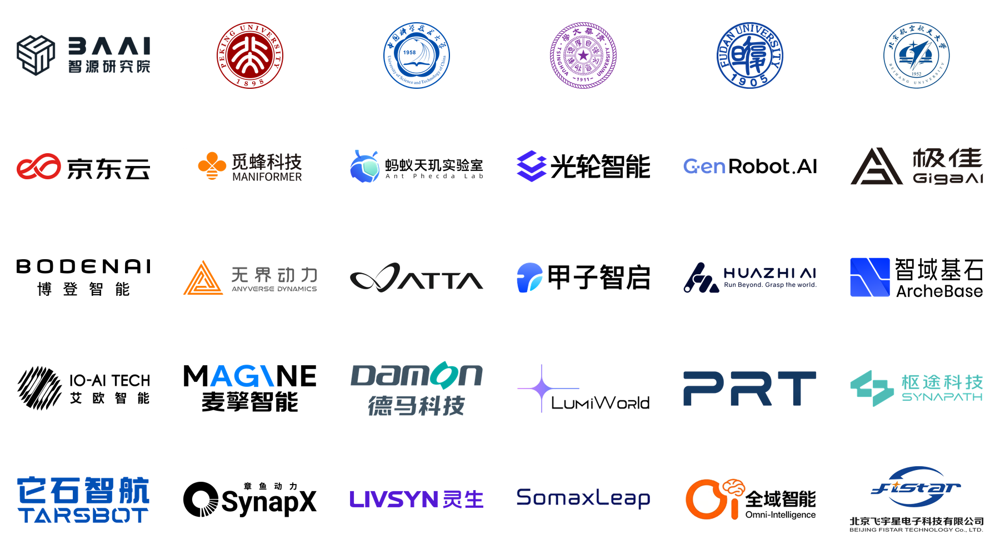
</p>
